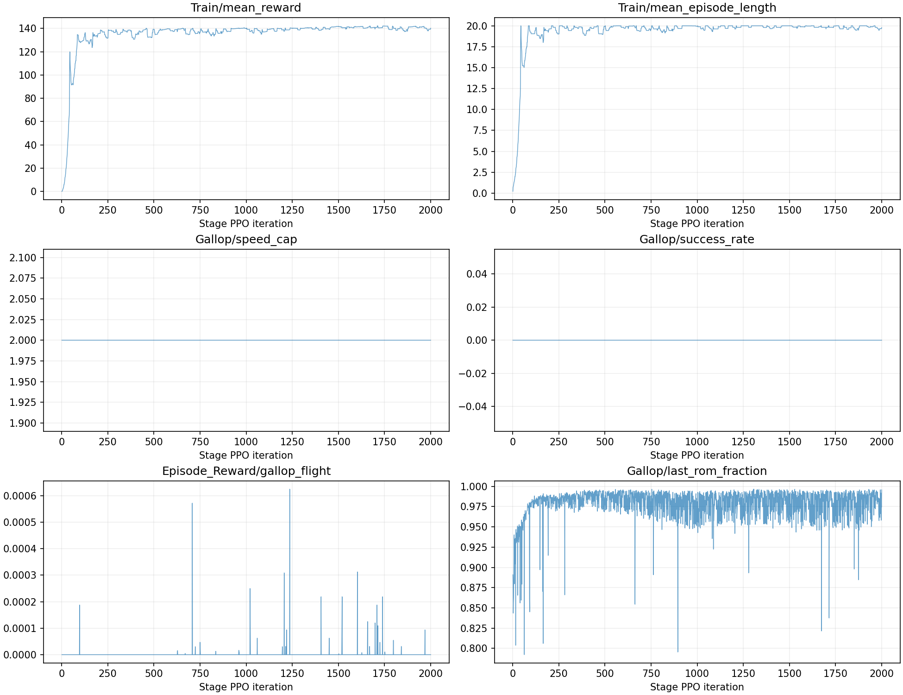
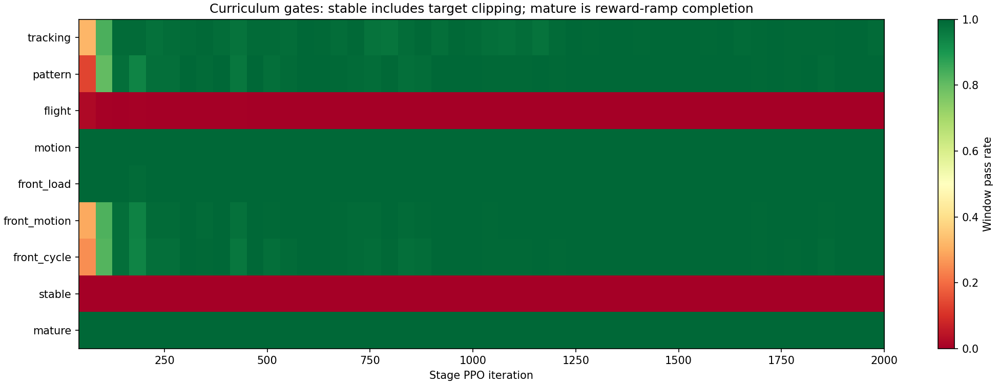
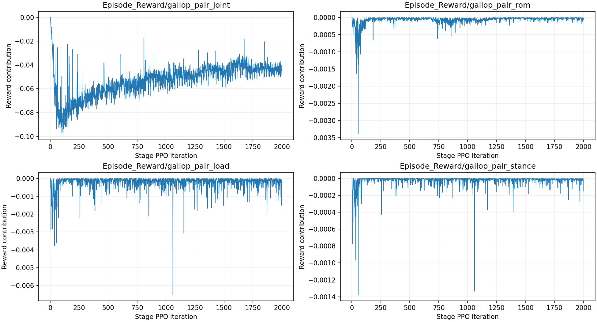
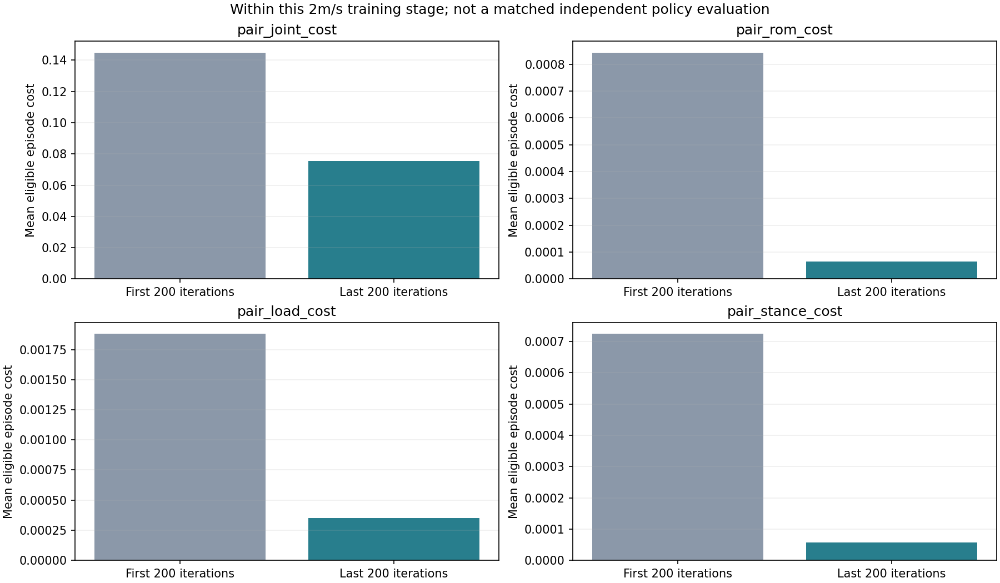
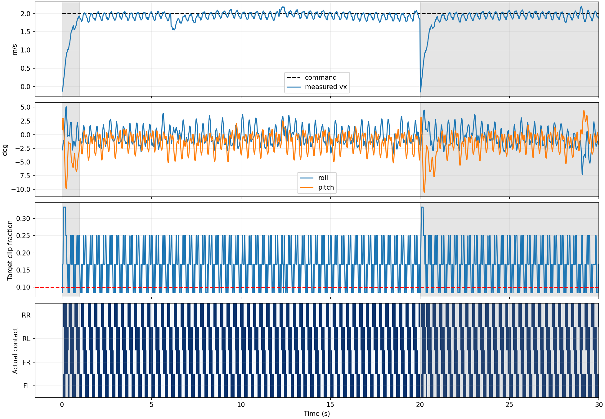
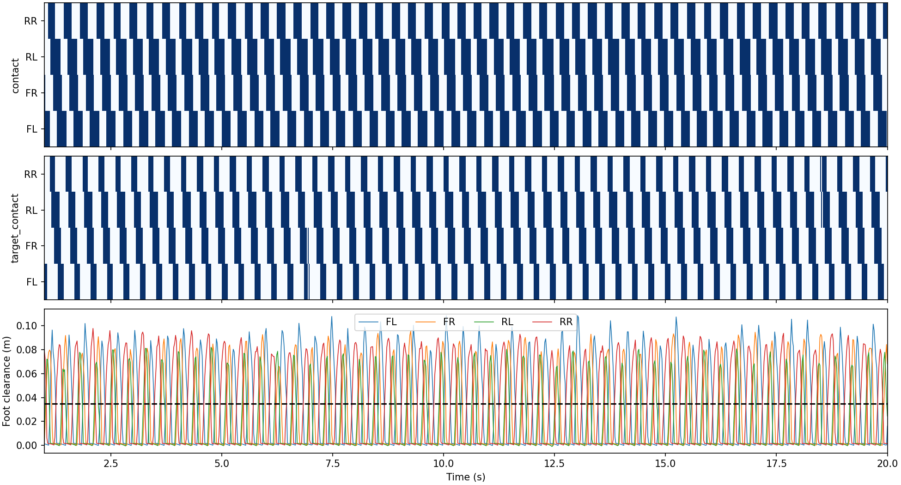
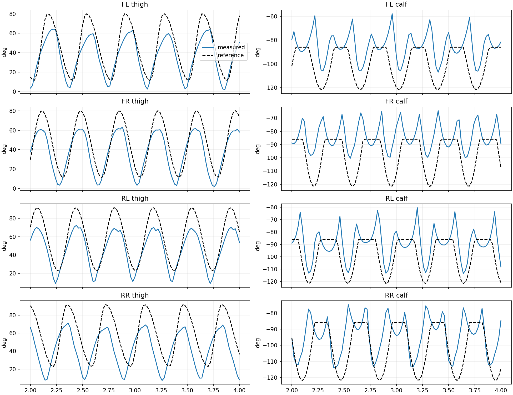
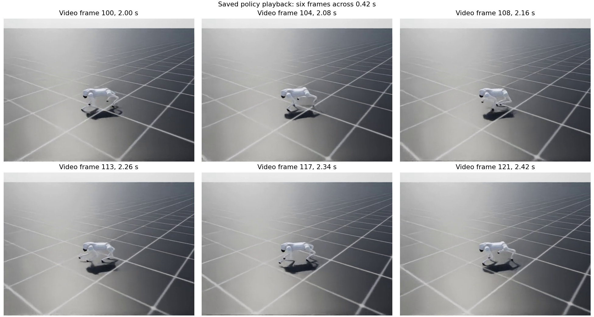

# 2026-10-29 2m/s·좌우 쌍 패널티 추가 학습 결과

현재 Gallop 모델에서 **2,000회 추가 학습을 완료**했다. 새 플레이에서2.0m/s 명령에 실제 평균 **1.935m/s**, 완전한 참조주기당 전진거리 **0.716m**를 확인했다. 이전1m/s 정책의0.424m보다 약69% 길게 전진한다. **공중기 성공 기준과 목표각 clipping 기준은 미달하여 속도 상한은 2.0m/s에 머물렀다.** 3.0m/s 학습에 도달하지 않았다.

학습 체크포인트·로그·TensorBoard·설정과 사용자가 완료한 **30초 플레이 영상·trace**를 수집했다. 현재 에이전트 세션은 CUDA를 사용할 수 없어 시뮬레이터를 직접 실행하지 않았으며, 수집 중 확인된 `20261029_130340_aec1b4` 플레이를 분석했다. 학습 중 통계와 별도 플레이 실측을 아래에서 구분한다. 본학습 영상은0개, 최종 정책 플레이 영상은1개다.

## 최종 모델과 플레이 명령

[최종 model_final.pt](../../runs/isaac/train/unitree_go2_gallop/20261029_123734_c563b2/model_final.pt)

```bash
cd /home/cvr/GH/go2_animalization/gallop
./isaac.sh gallop play --num-envs 1 --steps 1500 \
  --checkpoint runs/isaac/train/unitree_go2_gallop/20261029_123734_c563b2/model_final.pt \
  --video --video-length 1500
```

기본 입력은 이 모델의 `trained_speed_cap`을 읽은 **vx=2.0m/s, vy=yaw=0**이다. 30초 재생하며 영상과 `gallop_trace.npz`를 새 `runs/isaac/play/unitree_go2_gallop/<실행ID>/`에 저장한다. 화면 없이 녹화하려면 `--headless`를 추가한다.

플레이는 학습 폴더의 SHA256 검증된 core/env source와 설정을 복원한다. 이전 1m/s 모델용 플레이 폴더 `20261029_110531_367535`의 결과를 이 새 모델의 성능으로 사용하지 않는다.

## 최종 정책 플레이 실측

[30초 플레이 영상](../../runs/isaac/play/unitree_go2_gallop/20261029_130340_aec1b4/videos/gallop-play-step-0.mp4) · [원본 trace](../../runs/isaac/play/unitree_go2_gallop/20261029_130340_aec1b4/gallop_trace.npz)

이 플레이는 새 최종 체크포인트 해시와 일치하며 policy_updates=0 / policy_state_unchanged=true다. 1환경1,500step, 입력은 전체 구간에서2/0/0이다. 초기1초와20초 자연timeout 이후를 제외한 **1~20초,951개 표본**을 분석했다. `terminated=0, timed_out=1`이므로 첫20초 종료는 낙상이 아니다.

| 항목 | 실측 |
|---|---:|
| 평균 실제 전진속도 | **1.93505m/s** |
| 전진속도 RMSE | 0.11519m/s |
| 횡속도 / yaw RMSE | 0.08838m/s / 0.11040rad/s |
| 평면 순변위 | 36.640m |
| 완전한 참조주기당 전진거리 | **0.71590m**,51주기 |
| roll / pitch RMS | 0.02667 / 0.03572rad |
| 몸 높이 범위 | 0.318~0.357m |
| 앞다리 전체 하중 분담 | **50.48%**, 두 앞다리 중 작은 값24.48% |
| 앞다리 실제 ROM/목표 | 93.93%, 두 앞다리 중 작은 값93.90% |
| 각 앞발 지지·스윙 참여율 최솟값 | 100% |
| 좌우 관절 비용 | 0.05552 |
| 주기 ROM·하중·지지시간 편중 비용 | 모두0, 설정 허용폭 이내라는 뜻 |
| 목표각 clipping 평균 | **16.456%**, 허용10% 초과 |
| 공중기 포함 주기 비율 | 1/54=1.85%, 기준60% 미달 |
| 초기1초 이후 동시 비접촉 표본 | 0/951 |

episode에 누적된 전진 RMSE는0.11463m/s다. reward/통계는 interval event 전, trace 상태는 event 후에 기록되므로 다시 계산한0.11519와 소폭 다르다. 하중과 앞다리 ROM/참여율은 실행 중 episode 판정값을 사용했다.

주기당 전진거리는 참조 위상이 한 바퀴 도는 구간에서 body-forward 속도를 적분했다. 이전1m/s 플레이는44완전주기 평균0.42419m, 새 플레이는51주기0.71590m로 **약68.8% 증가**했다. 실제 평균속도도1.01086→1.93505m/s로 증가했다. 이는 **더 긴 보폭·주기 이동의 근거**이며,0.716m 전부를 공중에서 도약했다는 뜻은 아니다. 서로 다른 명령의 두 정책을 비교한 기술적 기록이며, 좌우 패널티의 단독 효과를 분리한 대조 실험은 아니다.

완전한 참조주기별 실제 관절 peak-to-peak 평균:

| 다리 | hip | thigh | calf |
|---|---:|---:|---:|
| FL | 9.17° | **59.25°** | 45.43° |
| FR | 7.42° | **58.35°** | 33.38° |
| RL | 9.29° | 59.89° | 49.76° |
| RR | **19.21°** | 58.86° | 37.76° |

이전1m/s 정책의 FL/FR thigh36.24°/42.06°보다 실제 앞다리 움직임이 커졌다. 다만 **완전한 좌우 대칭은 아니다.** 특히 RR hip19.21° 대 RL hip9.29° 차이가 남아 있고, pair ROM 비용은 thigh/calf만 보므로 그 비용0이 hip 움직임까지 같다는 뜻은 아니다. 하중/지지시간 비용도 허용폭 초과분만 벌점으로 계산한다. 한쪽 다리 의존이 완전히 없어졌다고 단정하지 않는다.

공중기 기록은 엄격히 구분한다. 첫20초에서 가장 긴 동시 비접촉 구간은0.04초로 초기1초 안에만 있었고, 이후20ms 저장 표본에서는 동시 비접촉이 없었다. 표본 사이의 짧은 공중기나 영상의 인상을 이 결과만으로 부정하지 않는다. 실제 지속 공중기와 도약거리는 더 촘촘한 물리step 기록으로 확인해야 한다.

## 완료와 설정 확인

| 항목 | 수집 결과 |
|---|---|
| 학습 폴더 | `runs/isaac/train/unitree_go2_gallop/20261029_123734_c563b2/` |
| 완료 상태 | completed / policy_updates=2,000 / model iteration=1,999 |
| 추가 학습량 | 256환경 × 24 step × 2,000회 = **12,288,000 transition** |
| 부모 | `20261028_181029_379d1c/model_final.pt`, 부모 누적10,000회 |
| 이번 완료 후 누적 | **12,000 iteration** |
| 학습 시간 | 2026-10-29 12:37:34~12:56:54 KST, 약19분14초 |
| 인터페이스 | actor47 / critic62 / action12, action scale0.5 |
| 초기화 | 기존 actor·critic·noise 복원, 새 Adam, 새 단계iteration0 |
| 시작·최저 속도 상한 | **2.0m/s**, 실제 학습 명령 범위1.8~2.0 |
| 목표 최대 상한 | 3.0m/s |
| 참조 속도 하한 | 1.0m/s로 분리 유지 |
| 2m/s 참조 | 주기0.37초, thigh±0.60rad, 발 높이9.25cm |
| 좌우 쌍 가중치 | joint0.6 / ROM0.5 / load0.5 / stance0.3 |
| 착지 순서 | 엄격 순서 필수 아님, 약한 보상0.1, 좌우 교환 허용 |
| gait strength | 전 구간1.0 |
| 속도 판단 | 48회, 승급0회, 모든 구간상한2.0 |
| 학습 영상 | **0개**. 수집 시 해당 실행 폴더에 MP4/영상 디렉토리 없음 |

최종 평균 reward는140.1737, 최근100회 평균140.6502이다. 최종 평균 episode 길이는19.781초, 최근100회 평균19.841초다. 이전1m/s 실험과 명령·보상이 다르므로 reward의 대소만으로 성능을 비교하지 않는다.

## 학습 후반 상태

전체 episode 기록12,493개 중 초기 짧은 구간256개를 제외한 적격 episode는12,237개다. 아래는 **최근1,000iteration(control step24,000 이상)에 끝난 적격6,189개**의 집계다.

| 항목 | 후반 평균/통과율 | 해석 |
|---|---:|---|
| 전진 추종 RMSE | **0.11495m/s** | episode별 RMSE의 평균 |
| 속도 추종 조건 통과 | **99.18%** | vx·vy·yaw 조건 동시 통과 |
| 느슨한 접촉 패턴 통과 | 99.61% | 개별 엄격 착지 순서 제외 |
| 전체 실제 ROM/목표 | 97.80% | 정규화 후 clipping된 지표 |
| 앞다리 하중 분담 | **51.00%** | 양의 수직력 적분 기준 |
| 두 앞다리 중 작은 개별 하중 분담 | 24.91% | 한쪽 앞다리만 쓰는지 확인 |
| 앞다리 실제 ROM/목표 평균 | 95.13% | 앞다리 가동 조건 통과99.74% |
| 앞발 지지·스윙 참여율 중 최솟값 | 98.42% | 참여 조건 통과99.61% |
| 몸 자세 RMS | 0.04912rad | episode별max(roll/pitch RMS)의 평균 |
| 자연 timeout 비율 | 98.93% | 물리 종료가 대부분이라는 뜻이 아님 |
| 목표 관절각 clipping | **16.389%** | 허용10% 초과 |
| 공중기 포함 주기 비율 | **2.065%** | 최소0.04초 all-off가 있는 주기 비율 |
| 공중기 성공 조건 통과 | **3/6,189 = 0.0485%** | 요구조건: 주기의60% 이상 |
| 복합 stable 조건 통과 | **0%** | 생존·자세·clipping을 함께 검사 |
| 전체 성공 | **0%** | 이에 따라2.0 이상 승급 없음 |

**학습 episode 로그 자체에는 실제 평균 전진속도가 없다.** 학습의2.0 상한을 실측 평균으로 표기하지 않는다. 별도로 수집한 최종 정책 플레이의 평균1.935m/s 및 주기당 전진거리0.716m는 위 플레이 절의 trace 기반 실측이다.

## 좌우 쌍 패널티 지표의 변화

이번2m/s 학습 안에서 처음200iteration에 끝난 적격1,091개와 마지막200iteration에 끝난 적격1,168개를 비교했다. 비용은 작을수록 해당 패널티 기준의 편중이 작다.

| 항목 | 초기200회 | 마지막200회 | 변화 |
|---|---:|---:|---:|
| 위상 보정 좌우 관절 비용 | 0.144845 | **0.075516** | **−47.9%** |
| 실제 ROM 불균형 비용 | 0.00084334 | 0.00006505 | −92.3% |
| 누적 하중 불균형 비용 | 0.00188000 | 0.00035230 | −81.3% |
| 지지시간 불균형 비용 | 0.00072403 | 0.00005650 | −92.2% |
| 전진 추종 RMSE | 0.21904m/s | 0.11510m/s | −47.5% |
| 몸 자세 RMS | 0.08023rad | 0.04804rad | −40.1% |
| 목표각 clipping | 14.459% | 16.364% | 증가 |

조기 실패가 감소한 효과를 분리해 보기 위해 자연 timeout까지 생존한 episode만 비교해도 관절 비용은0.142499→0.075244(**−47.2%**)다. 해당 집계는초기988개/후기1,153개이며, ROM·하중·지지시간 비용도 각각약90.2%/46.7%/70.3% 감소했다. 세부값은 [within_training_comparison.json](within_training_comparison.json)에 있다.

이는 학습 중 지표가 개선됐다는 근거다. **한 발 의존이 완전히 사라졌다거나 영상 모션이 좋아졌다는 확정은 아니다.** 고정 seed·명령·초기 상태로 부모/최종 정책을 나란히 재생한 비교가 아니며 속도 변경과 새 보상/optimizer 효과를 분리한 실험도 아니다. 이전1m/s 영상에서 계산한 비용과 직접 비교해 패널티 단독 효과를 주장하지 않는다.

## 승급 실패 원인

이전 학습에는 없었던 `action_clip_fraction`, `terminated`, `timed_out`을 이번에는 episode마다 기록했으므로 stable 실패를 분리할 수 있었다. 적격12,237개 전체에 대해 기록된 stable 값과 코드의 생존·자세·clipping 조건을 다시 계산해 일치함을 확인했다.

최근6,189개에서 clipping 기준을 초과한 것은 **6,176개(99.79%)**다. 이 중 **6,123개는 clipping만으로 stable을 실패**했다. 조기 종료는66개, 자세 RMS 초과는14개다(항목 간 중복 있음). 따라서 stable0%를 전부 낙상으로 읽으면 안 된다. clipping은 soft joint limits를 벗어나려는 **명령 목표를 제한한 비율**이며 실제 관절이 기계적 한계를 넘어갔다는 뜻도 아니다.

공중기 포함 주기 비율의 중앙값은약1/53이다. 이 집계에는 초기 구간이 포함돼 있으며, 특정 공중기가 언제 발생했는지·얼마나 멀리 도약했는지는 trace 없이 확정하지 않는다. 또한0.04초 미만의 짧은 공중기까지 없다고 단정하지 않는다. 현 성공 조건을 거의 통과하지 못했다는 것이 수집 가능한 결론이다.

개별 착지 순서 정확도는 후반평균0.85%지만 `require_touchdown_order=false`이므로 승급 실패의 필수 원인은 아니다. 속도 판단48회 중 자료부족1회, hold47회였고 승급은0회였다.

## 저장 자료와 다음 확인

- [summary.json](summary.json): 학습 완료·계보·설정·TensorBoard·episode 후반 집계와 matching 플레이 실측. `rollout_status=collected`.
- [play_analysis.json](play_analysis.json), [play_diagnostics.json](play_diagnostics.json), [play_state_trace.csv](play_state_trace.csv): 플레이 분석·주기 이동·좌우 비용·상태 표본.
- [parent_play_comparison.json](parent_play_comparison.json): 이전1m/s와 새2m/s 플레이의 조건 및 수치 비교.
- [training_diagnostics.json](training_diagnostics.json): 전체/초기200회/후기200회/후기1,000회 집계와 stable 실패 조합.
- [within_training_comparison.json](within_training_comparison.json): 적격 전체와 자연timeout 생존 episode만의 전후 비교.
- [train_episodes.csv](train_episodes.csv), [tensorboard_scalars.csv](tensorboard_scalars.csv), [curriculum_decisions.csv](curriculum_decisions.csv).
- [videos.csv](videos.csv): 본학습 영상0개, 최종 정책 플레이 영상1개.
- `params/`, [gallop_config.json](gallop_config.json): 실제 학습 설정 사본.
- [evidence_manifest.json](evidence_manifest.json), [verification.json](verification.json): 원본 파일/모델 해시와 완료·계보·CSV·source 검증.

















수집 재현(새 보고서 경로 사용):

```bash
OPENBLAS_NUM_THREADS=1 OMP_NUM_THREADS=1 MKL_NUM_THREADS=1 \
MPLCONFIGDIR=/tmp/go2-gallop-isaac-matplotlib \
.isaacvenv/bin/python -m scripts.analysis.collect_gallop \
  --train runs/isaac/train/unitree_go2_gallop/20261029_123734_c563b2 \
  --play runs/isaac/play/unitree_go2_gallop/20261029_130340_aec1b4 \
  --output reports/새_학습_보고서
```

다음 검토는 남아 있는 RR hip 편중, 목표각 clipping과 공중기 기준의 병목이다. 이번 수집에서는 PPO 업데이트0회이며 보상·학습 설정·모델을 변경하지 않았다. 학습과 플레이의 무작위화/밀기 이벤트가 켜진 기존 설정을 그대로 분석했으며 단일 플레이를 다중seed 성공률로 일반화하지 않는다. MuJoCo Sim2Sim과 실기는 아직 미검증이다.
