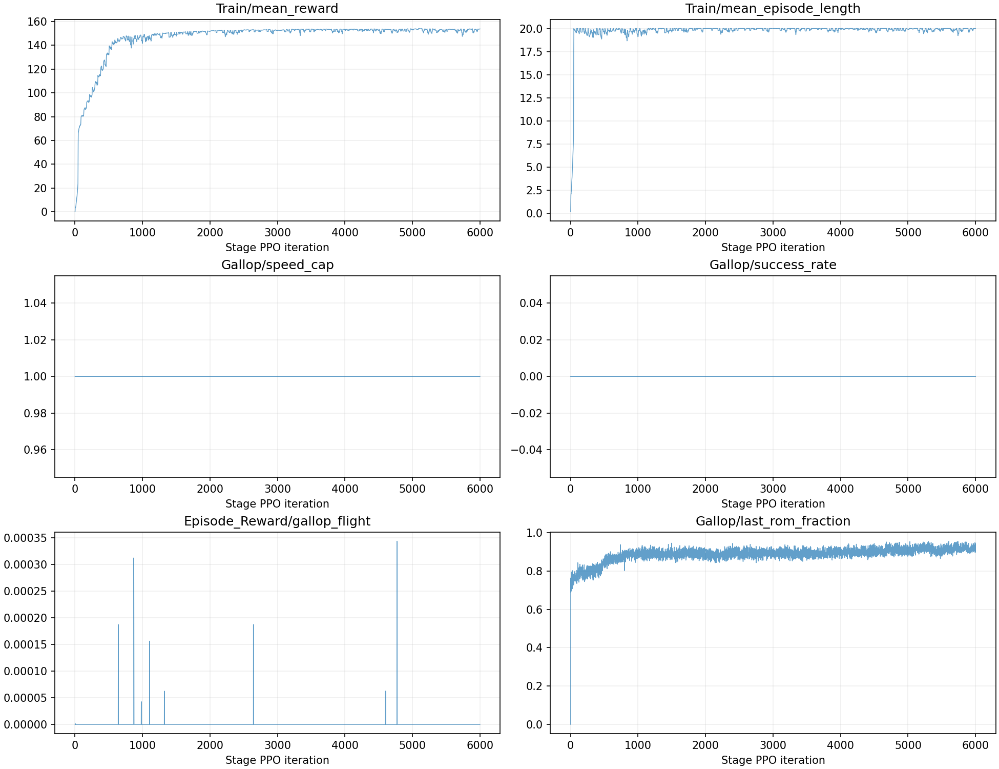
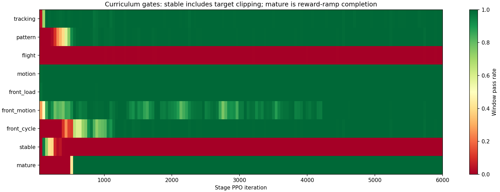
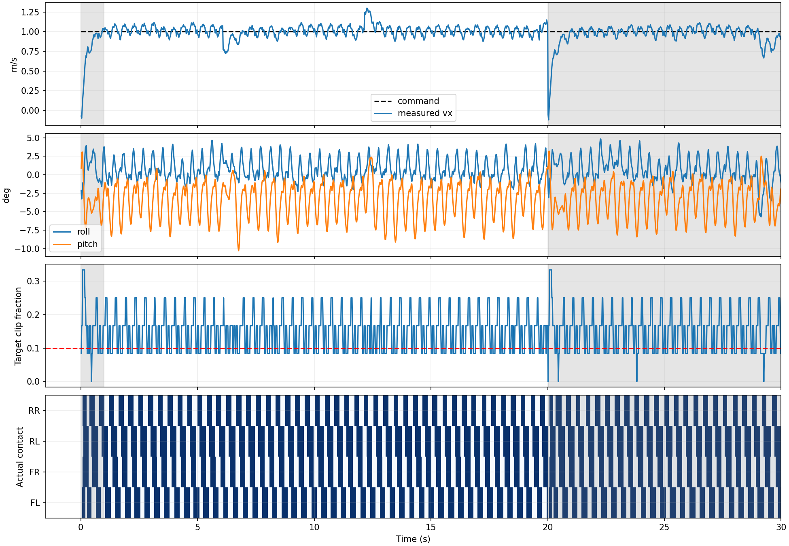
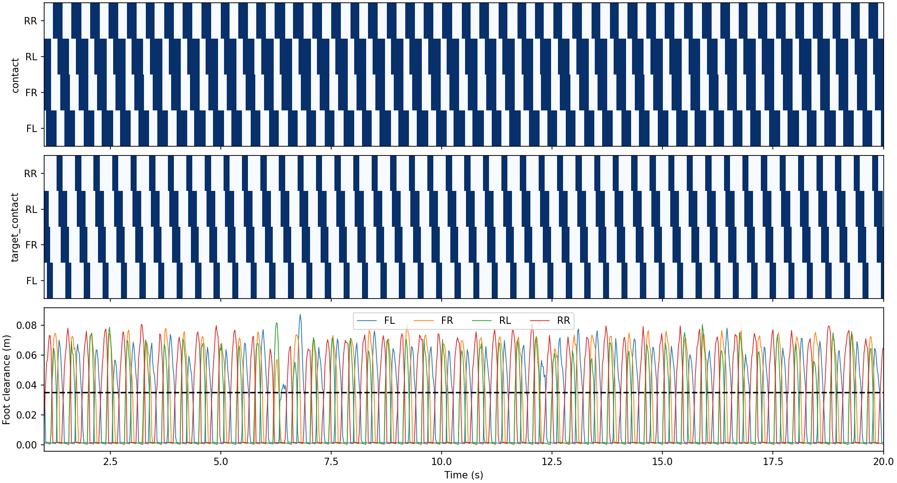
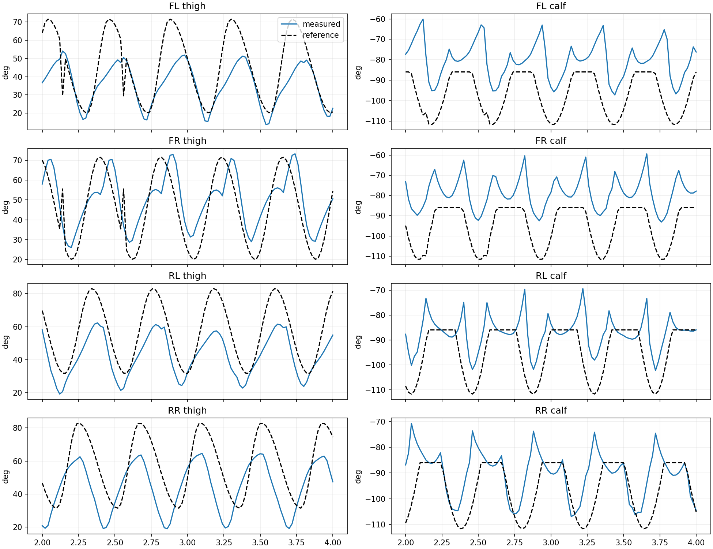
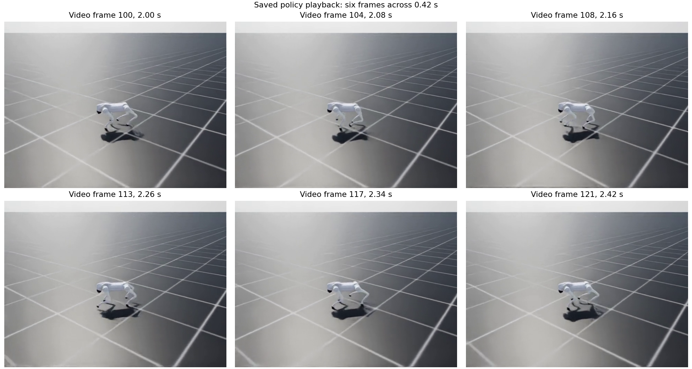

# 2026-10-29 Gallop 학습·플레이 결과 수집

사용자가 Gallop 추가 학습 6,000회를 완료했다. **1.0m/s 전진 추종, 앞다리 하중·관절 운동·스윙 참여는 확인했으나, 공중기와 목표각 clipping 조건에서 실패해 고속 Gallop 목표에는 도달하지 못했다.** 속도 상한은 1.0m/s 그대로이며 3.0m/s 주행 결과는 없다.

이번 작업은 저장된 체크포인트·TensorBoard·episode 로그·플레이 trace·영상을 오프라인으로 수집한 것이다. 추가 학습이나 새 시뮬레이션은 실행하지 않았다. 아래 성공률은 구현된 공학적 판정 조건이며 엄밀한 동물 보행 분류 정확도를 뜻하지 않는다.

## 학습 출처와 완료 확인

| 항목 | 결과 |
|---|---|
| 학습 실행 | `runs/isaac/train/unitree_go2_gallop/20261028_181029_379d1c/` |
| 최종 모델 | [model_final.pt](../../runs/isaac/train/unitree_go2_gallop/20261028_181029_379d1c/model_final.pt) |
| 학습 상태 | completed / policy_updates=6,000 / 최종 model iteration=5,999 |
| 새 학습량 | 256환경 × rollout 24 × 6,000회 = **36,864,000 transition** |
| 부모 정책 | `unitree_go2_forward_only/20261028_160258_54620c/model_final.pt`, 누적 4,000회 |
| 누적 iteration | 부모 4,000 + 새 Gallop 6,000 = **10,000회** |
| 정책 인터페이스 | `unitree_go2_gallop_47_62_12_v1`, actor 47 / critic 62 / action 12 |
| 학습 시각 | 2026-10-28 18:10:29 실행 시작, 19:09:09 완료(KST), 약 58분 31초 |
| 최종 평균 reward | 153.6724, 최근 100회 평균 152.7340 |
| 최종 episode 길이 | 20.00초, 최근 100회 평균 19.913초 |
| 학습 episode 로그 | 전체 37,332개 / 승급 통계 적격 37,076개 |
| 속도 curriculum | 판단 144회, 승급 0회, 모든 구간 상한 **1.0m/s** |
| 학습 영상 | 10초 MP4 15개, step 0~140,000까지 10,000 간격 |

공식 별도 checkout 커밋 `4960b84732b0c2ec593dccbfe963fda1bcd7b1e3`을 기반으로 한 Gallop 변형 환경이다. 넓은 plane, 위상 관측, Gallop 보상, action scale 0.5, 앞다리 조건 및 성공률 curriculum을 추가했으므로 공식 원본 task 그대로의 결과와 구분한다. 학습 시점 source snapshot과 현재 `gallop_core.py`/`gallop_env.py`의 SHA256은 일치한다.

## 최종 정책의 기존 플레이

[30초 플레이 영상](../../runs/isaac/play/unitree_go2_gallop/20261029_110531_367535/videos/gallop-play-step-0.mp4) · [원본 trace](../../runs/isaac/play/unitree_go2_gallop/20261029_110531_367535/gallop_trace.npz)

플레이 실행은 `20261029_110531_367535`, 1환경 × 1,500 step, 30초다. 입력은 전체 구간에서 **vx=1.0, vy=0, yaw=0**으로 확인했다. 모델 해시는 최종 학습 체크포인트와 일치하며 play의 policy_updates=0 / policy_state_unchanged=true다.

분석은 초기 1초와 첫 reset 이후를 제외한 **1.0~20.0초의 첫 연속 구간(951개 표본)**을 사용했다. reset 1회는 20초 경계에 있다. trace의 reset 행은 reset 이전 terminal 상태이며 이후 행은 성능 집계에서 제외했다. 개별 종료 이유는 플레이 로그에 없으므로 reset 자체를 낙상으로 해석하지 않는다.

| 항목 | 측정 결과 | 판정/해석 |
|---|---:|---|
| 실제 평균 전진 속도 | **1.0109m/s** | 1.0 명령 추종 |
| 전진 속도 RMSE | **0.0710m/s** | 기준 0.25m/s 이내 |
| 횡속도 RMSE | 0.0794m/s | 기준 0.15 이내 |
| yaw-rate RMSE | 0.0825rad/s | 기준 0.3 이내 |
| 평면 순변위 | 19.28m | 분석 구간 양 끝 위치 차이 |
| roll / pitch RMS | 0.0283 / 0.0734rad | 기준 0.25 이내 |
| 몸 높이 범위 | 0.326~0.371m | 높이 종료 범위 0.18~0.60 이내 |
| 접촉 패턴 일치율 | 82.60% | episode 기록, 기준 60% 통과 |
| 전체 실제 ROM / 목표 | 92.98% | episode 기록, 기준 70% 통과 |
| 공중 시간이 차지하는 비율 | **0%** | 초기 1초 이후, 네 발 모두 off인 표본 없음 |
| 공중기 포함 주기 비율 | **1/47 = 2.13%** | episode 기록, 기준 60% 미달 |
| 목표 관절각 clipping 평균 | **14.73%** | 기준 10% 초과 |

episode 누적 속도 RMSE는 0.07022m/s다. runtime reward/통계 누적은 interval event 전, 저장 trace는 event 후 상태를 사용하기 때문에 trace에서 다시 계산한 0.07101과 조금 다르다. 표의 하중/ROM/주기 참여 비율은 실행 중 episode 판정값을 사용했다.

플레이 첫 연속 구간 전체에서 가장 긴 all-off 구간은 0.04초였고 초기 1초 안에만 존재했다. 따라서 2.13%라는 주기 비율을 지속적인 비행이나 체공 시간 비율로 읽으면 안 된다. 접촉은 설정된 8N on / 3N off 센서 히스테리시스 기준이다.

## 앞다리를 사용하는가

**이 플레이에서는 뒷다리만으로 뛰는 패턴을 막기 위한 세 종류의 앞다리 조건이 모두 통과했다.** 추진력 분담 자체는 별도로 측정하지 않았으며 아래 하중은 양의 수직 접촉력 적분으로 근사한 분담이다.

| 앞다리 조건 | 측정 | 기준 | 결과 |
|---|---:|---:|---|
| 앞다리 전체 수직 충격량 분담 | **49.47%** | 25% 이상 | 통과 |
| 두 앞다리 중 작은 개별 분담 | **22.76%** | 8% 이상 | 통과 |
| 뒷다리 전체 분담 | 50.53% | 25% 이상 | 통과 |
| 앞다리 실제 ROM / 목표 평균 | **84.19%** | 70% 이상 | 통과 |
| 앞다리 개별 ROM 중 최솟값 | **77.66%** | 50% 이상 | 통과 |
| 각 앞발 지지·스윙 참여율 중 최솟값 | **97.87%** | 70% 이상 | 통과 |

주기 참여는 각 앞발이 한 주기에 지지 0.06초 이상, 높이 3.5cm 이상인 스윙 0.04초 이상을 모두 수행했는지 확인한다. ROM은 실제 thigh/calf 움직임을 참조 진폭에 대해 정규화한 값이다.

1~20초 안의 완전한 참조 위상 주기 44개에서 측정한 주기별 관절 peak-to-peak 평균은 다음과 같다. 이는 독립적인 보행 분류로 추출한 stride가 아니라 **부여된 위상 주기** 단위다. 10월 29일 추가 점검에서 reset 직후 위상 감소를 주기 경계로 읽어 포함됐던 마지막 불완전 구간 1개를 제외했다. 속도·접촉·앞다리 성공 판정 결과는 동일하다.

| 다리 | hip | thigh | calf |
|---|---:|---:|---:|
| FL | 7.09° | 36.24° | 33.55° |
| FR | 8.38° | 42.06° | 31.18° |
| RL | 9.90° | 37.24° | 29.07° |
| RR | 12.11° | 43.91° | 31.33° |

## 속도가 올라가지 않은 이유

최근 1,000iteration 구간에 종료된 적격 episode **6,176개**를 다시 집계했다. 구간 시작 control step은 120,000이며, 마지막 판단 step은 144,000이다.

| 필수 항목 | 학습 후반 통과율 | 최종 플레이 episode |
|---|---:|---|
| 속도 추종 tracking | 99.51% | 통과 |
| 느슨한 접촉 패턴 pattern | 99.69% | 통과 |
| 공중기 flight | **0.16%** | 실패 |
| 전체 관절 운동 motion | 100% | 통과 |
| 앞다리 하중 front_load | 99.92% | 통과 |
| 앞다리 ROM front_motion | 99.87% | 통과 |
| 앞발 지지·스윙 front_cycle | 99.69% | 통과 |
| 생존·자세·목표각 clipping 복합 stable | **0%** | 실패 |
| 보상 램프 완료 mature | 100% | 통과 |
| 모든 필수 조건 동시 충족 success | **0%** | 실패 |

6,176개 중 **6,133개(99.30%)는 flight와 stable 두 항목만 실패**했다. 승급은 최소 128개 적격 episode 구간에서 성공률 80% 이상이 두 번 연속 필요하므로 144회 모두 hold가 나온 것은 현재 코드와 일치한다.

`stable=false`는 낙상만 뜻하지 않는다. 자연 timeout까지 생존, 자세 RMS, 목표각 clipping을 함께 검사한다. 최종 플레이는 자세 조건을 충족하지만 **목표각 clipping 14.73% > 10%**이므로 이 항목에서 실패한다. 이는 soft joint limits를 넘어가려는 **명령 목표를 제한한 비율**이며 실제 관절이 물리 한계를 넘어갔다는 뜻이 아니다. 학습 episode JSONL에는 clipping 평균의 개별 값이 없어서 학습 전체의 stable 실패 원인을 clipping 하나로 확정할 수는 없다. 학습 최근 100회 timeout 항은 약 99.09%이고 몸 자세 RMS도 작아 stable 0%를 전부 낙상으로 설명할 수 없다.

개별 착지 순서 정확도는 플레이 1.04%로 낮지만 `require_touchdown_order=false`이므로 **승급 실패 원인이 아니다**. 사용자가 요청한 느슨한 순서 조건은 적용되어 있다. 이 결과만으로 trot/bound/순수 Gallop 중 하나로 확정하지 않는다.

## 저장한 결과와 재현

- [summary.json](summary.json): 학습 완료·계보·모든 scalar 요약·episode 집계·영상 색인.
- [play_analysis.json](play_analysis.json), [play_state_trace.csv](play_state_trace.csv): 첫 연속 구간 분석과 전체 30초 상태 표본.
- [train_episodes.csv](train_episodes.csv), [play_episodes.csv](play_episodes.csv), [curriculum_decisions.csv](curriculum_decisions.csv).
- [tensorboard_scalars.csv](tensorboard_scalars.csv): 저장된 전체 scalar 원본 내보내기.
- [videos.csv](videos.csv): 학습 영상 15개와 플레이 영상 1개의 원본 경로·프레임 수·길이. 모든 MP4의 첫 프레임 디코딩과 프레임 수 확인.
- `params/`, [gallop_config.json](gallop_config.json): 실제 학습 설정 사본.
- [evidence_manifest.json](evidence_manifest.json): 원본 실행 파일들의 크기와 SHA256. 수집 전후 최종 모델 해시가 같다.
- [verification.json](verification.json): 원본 108개 파일의 해시 재확인, 실제 모델 47/62/12 구조, CSV 행 수, trace 재계산, 문서 링크와 공식 checkout clean 확인 결과.
- [수집 코드](../../scripts/analysis/collect_gallop.py): 학습/시뮬레이터를 구동하지 않는 오프라인 수집기.













다른 새 보고서 폴더로 재수집할 때:

```bash
cd /home/cvr/GH/go2_animalization/gallop
OPENBLAS_NUM_THREADS=1 OMP_NUM_THREADS=1 MKL_NUM_THREADS=1 \
MPLCONFIGDIR=/tmp/go2-gallop-isaac-matplotlib \
.isaacvenv/bin/python -m scripts.analysis.collect_gallop \
  --train runs/isaac/train/unitree_go2_gallop/20261028_181029_379d1c \
  --play runs/isaac/play/unitree_go2_gallop/20261029_110531_367535 \
  --output reports/새_보고서_이름
```

## 이어서 볼 항목

다음 설계 검토의 우선순위는 **공중기 학습이 정체된 이유**와 **관절 목표/보상이 clipping을 유도하는지**다. 학습 episode별 clipping 평균과 종료 사유를 따로 기록하면 stable 실패를 분리할 수 있다. 아직 학습 설정·판정 기준을 변경하지 않았으며 기존 모델과 로그를 보존했다. 학습은 계속 사용자가 직접 수행한다.

현재 평가는 기존 단일 환경 플레이 한 번에 한정된다. 원래의 무작위화·외란 이벤트가 켜져 있으며 별도 nominal 다중 seed 시험은 하지 않았다. 새 47/62/12 정책의 MuJoCo Sim2Sim, Trot→Gallop 전환, 실제 Go2 EDU 검증도 아직 없다.

## 추가 판단: 속도를 2m/s로 올리면 더 길게 도약할 수 있는가

사용자는 영상에 공중기가 보이며, 현재 속도가 낮아서 한 주기의 전진 거리가 짧다는 가설을 제시했다. **현재 Gallop 정책에서 2m/s 조건으로 추가 학습하는 것은 타당한 다음 실험이다.** 수평 속도가 증가하면 같은 체공시간에도 공중에서 전진하는 거리가 늘어나므로, 기존의 앞다리 참여·접촉 리듬을 유지하면서 더 길게 뻗는 모션을 학습할 물리적 근거가 있다. 개선 가능성에 대한 판단이며 아직 2m/s 실제 결과는 없다.

현재 `phase_targets`의 속도 기준 1~3m/s를 그대로 유지할 때의 참조값:

| 항목 | 1m/s | 2m/s |
|---|---:|---:|
| 한 전체 보행 주기 | 0.42초 | 0.37초 |
| 목표 속도 × 주기 | 0.42m | 0.74m |
| 참조 주파수 | 2.38Hz | 2.70Hz |
| thigh 참조 진폭 | ±0.45rad | ±0.60rad |
| 스윙 발 높이 참조 | 6.5cm | 9.25cm |
| 참조에서 네 발이 모두 off인 구간 | 0.063초 | 0.0555초 |
| 위 참조 공중구간의 수평 이동거리 | 6.3cm | 11.1cm |

표는 **명령을 추종하고 참조 접촉을 수행했을 때의 계산값**이며 실제 2m/s 주행 측정값이 아니다. 한 주기 전체 전진거리는 약 76% 증가한다. 기존 1m/s trace에서 완전한 44주기에 대해 body-forward 속도를 적분한 평균은 0.4242m로 저속 계산과 일치했다.

수평 도약거리는 대략 `전진 속도 × 실제 체공시간`이다. 수평 속도를 두 배로 높이는 것 자체가 체공시간·도약 높이까지 두 배로 강제하지는 않는다. 현재 코드도 참조 주기를 조금 줄이므로 참조 공중시간은 오히려 짧아진다. 속도는 긴 수평 이동을 요구하지만, 더 빠른 발 교대나 다른 패턴으로 대응할 수도 있어 앞다리 참여·리듬·공중기 보상은 유지할 이유가 있다.

공중기 표현도 구분한다. 기존의 0%는 **20ms 간격으로 저장한 첫 플레이 구간에서 동시 비접촉 표본이 없었다**는 뜻이다. 영상의 다른 구간이나 표본 사이의 짧은 공중기까지 없다고 단정하지 않는다. 다만 해당 951개 표본에서는 접촉 임계값을 1~20N로 바꿔도 동시 비접촉은 없었고, 매 표본 적어도 한 발에 수직력이 35.66N 이상이었다. 짧은 공중기를 확인하려면 5ms 물리 step의 동시 접촉 기록이 필요하다. 현 40ms 이상/주기 60% 성공 기준을 만족했다는 증거는 아니다.

선행 연구에서도 속도에 따른 보행 변화가 관찰됐다. [Fu et al., CoRL 2021](https://energy-locomotion.github.io/)은 에너지 기반 학습에서 속도에 따른 walk/trot/bounce 계열 동작의 출현을 보였다. [Yang et al., 2021, §5.2](https://arxiv.org/html/2104.04644v2)는 Unitree A1에서 고속으로 갈 때 공중기가 있는 trot가 나타났으며 gallop이 자동으로 선택되지는 않았다고 보고했다. 따라서 고속화로 동작이 달라질 근거는 있지만, Go2에서 2m/s가 특정 보행을 보장하는 경계값은 아니다.

구현 시 **`start_speed`만 2로 바꾸면 안 된다.** 이 값이 curriculum 초기 상한과 참조곡선 정규화의 하한을 겸한다. 그렇게 바꾸면 2m/s의 참조가 다시 0.42초/±0.45rad/6.5cm로 계산되어 표의 고속 참조가 사라진다. 기존 1~3m/s 참조곡선과 초기 학습 상한을 분리하고, 현재 47/62 Gallop 체크포인트에서 이어 학습하도록 연결하는 것이 의도에 맞다. 현재 runner의 train은 45/60 전진 모델 이식만 지원하므로 Gallop→Gallop 추가 학습 복원도 구현이 필요하다.

이번에는 코드·로그·논문에 근거한 판단과 계산만 수행했다. GPU/CUDA 연결이 없어 새 동역학 재생은 하지 않았으며 학습 설정과 체크포인트도 변경하지 않았다. 계산과 표본 점검은 [speed_2mps_assessment.json](speed_2mps_assessment.json)에 저장했다.

후속 단계: 사용자의 좌우 쌍 패널티 요청에 따라 Gallop→Gallop 추가 학습, 시작 속도/참조 하한 분리와2m/s 프리셋을 추가했고, 이후 사용자가2,000회를 완료했다. [새2m/s 모델·플레이 수집](../20261029_gallop_2mps_pair_review/README.md)에서 최신 결과를 확인한다. 이 문서의 수치는 변경 전6,000회1m/s 정책의 기록이다.
