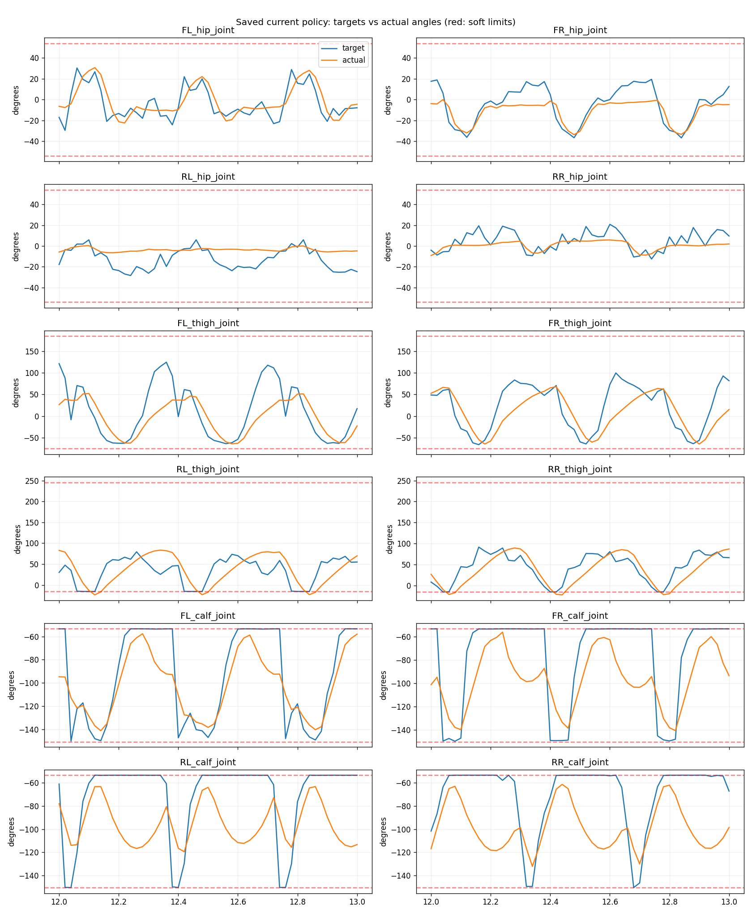

# 관절 범위 정책 결과와 모션 변화 조사 — 2026-11-03

**관절 목표각 제한은 정상 작동했다. 하지만 범위 안에서 명령이 급변하고 한계 근처에 오래 머무르는 문제가 남았다.** 현재 플레이에서 목표각 soft-limit 이탈과 실제 관절의 기계적 hard-limit 이탈은 모두0%다. 실제 관절의 soft-limit 이탈은1.81%, 목표각 한계 근접은28.73%다. 각도 범위 제한만으로 자연스럽고 추종 가능한 움직임까지 보장되지는 않았다.

이전보다 발폭과 roll은 개선됐지만, 명령 변화 속도와 경로 편차는 커지고 도약거리는 줄었다. 모방 직후와 PPO 후 모델을 같은 저장 관측에 대입한 결과도 동작 보존이 약해졌음을 보여준다. 다음 재학습에서 **각도+명령 속도 실행 제약, 제한 전후 명령 차이 비용, 모방 동작 유지, 실제 관절 soft 범위 평가**를 결합할 수 있다. [구체적인 조정 설계와 오프라인 제약 검증](retraining_design.md).

이번 작업은 기존 파일 수집·계산·정책 추론만 수행했다. PPO/모방 optimizer 갱신0, 새 물리 시뮬레이션0이다. 모델·학습 보상·설정·실행 코드는 변경하지 않았다.

## 완료 모델과 영상

| 항목 | 결과 |
|---|---|
| 학습 실행 | `20261103_100859_83b730` |
| 최종 모델 | [model_final.pt](../../runs/isaac/train/unitree_go2_gallop/20261103_100859_83b730/model_final.pt) |
| SHA256 | `167504719e5f3b0523893b69bc1a9c12bde5eeefb477a6fc26d1301abccb926d` |
| 학습량 | PPO2,000회 / 새12,288,000 transition / 계보24,000회 |
| 모방 단계 | 5,670 optimizer step, PPO와 별도 |
| 완료 | 2026-11-03 10:45:56 KST, 전체 실행2,210.42초 |
| 인터페이스 | `unitree_go2_gallop_bounded_49_64_12_v3`, actor49/critic64/action12 |
| 속도·거리 단계 | 2.2m/s·14cm, 승급0, `highest_confirmed_speed=null` |
| 사용자 플레이 | `20261103_123515_36ff0c`, 1,500step/30초, 자연timeout/낙상0 |
| 플레이 영상 | [29.98초 MP4](../../runs/isaac/play/unitree_go2_gallop/20261103_123515_36ff0c/videos/gallop-play-step-0.mp4) |
| 전체 영상 | 학습5개(각30초) + 플레이1개, [목록](videos.csv) |

손실 iteration0~1999와 최종 모델 iter1999/status2,000회로 학습 완료를 확인했다. 평균 리워드1994개는 첫6회에 완료 episode가 없었던 결과다. 최근100회 평균 리워드는417.24이며 이전 설정과 보상 구성이 달라 단순 성능 순위로 해석하지 않는다.

## 이전22,000회 모델과 비교

이전 모델은 [직전 수집 결과](../20261103_gallop_stabilization_review/README.md)다. 두 플레이 모두 명령2.2m/s·거리14cm이고 시작 방향도 같지만 제어 변환·noise·보상과 계측 시작 시점이 달라 단일 변경의 인과 효과를 분리한 실험은 아니다.

현재 정지→일반 보행→전환 후 공식 계측은8.70~30초/1,066표본/21.32초다. 이전은8.76~30초/1,063표본이다. 아래는 이 공식 구간 기준이다.

| 항목 | 이전22,000회 | 현재24,000회 |
|---|---:|---:|
| 실제 몸체 전진속도 | 2.425m/s | 2.311m/s |
| 전진속도 RMSE | 0.271m/s | 0.178m/s |
| roll RMS | 3.93° | 2.86° |
| pitch RMS | 3.13° | 3.17° |
| yaw 각오차 RMS | 2.16° | 4.92° |
| 몸체 z각속도 RMS | 0.182rad/s | 0.176rad/s |
| 최대 횡편차 | 0.723m | 3.557m |
| 세계 좌표 횡속도 RMS | 0.090m/s | 0.199m/s |
| 앞발 지지폭 허용24~30cm 유지율 | 82.62% | 99.00% |
| 뒷발 지지폭 유지율 | 78.13% | 90.29% |
| 평균 실제 도약거리 | 17.37cm | 15.99cm |
| 평균 공중시간 | 75.59ms | 72.71ms |
| 안정 회복 | 57/59, 96.61% | 55/59, 93.22% |
| 목표각 한계 근접 비율 | 26.47% | 28.73% |
| 목표각 변화 속도 절대값95백분위 | 37.43rad/s | 42.64rad/s |
| 목표각 변화 속도 최대 | 84.82rad/s | 90.40rad/s |
| 실제 관절 추종 RMSE | 0.530rad, 30.39° | 0.540rad, 30.96° |

추종 오차 약31°가 이번에 갑자기 생긴 것은 아니다. 다만 명령 급변이 증가했고, 모방 목표에서 벗어나며 횡방향 이동도 커졌다. 몸체 좌표에서 전진·횡속도와 z각속도를 보는 기존 `tracking=1`을 월드+X 방향 직진 성공으로 해석하면 안 된다. 현재 공식 구간 횡변위는−4.075m다.

## 관절 제한은 어디까지 지켰는가

모델의 기계적 범위가 hard-limit이고, 기존 제어가 사용하는 범위는 그 중앙90%인 soft-limit이다. 목표각은 관절별 soft-limit 안에서 생성되며 마지막 안전 제한도 적용된다.

| 확인 대상 | 현재 공식 구간 |
|---|---:|
| 실행 목표각 soft-limit 이탈 | 0% |
| 실제 관절 hard-limit 이탈 | 0% |
| 실제 관절 soft-limit 이탈 | 전체 관절 표본의1.81% |
| 실제 soft 범위 최대 초과 | 0.184rad, 약10.52° |
| 토크 포화 | 전체 관절 표본의12.45% |

실제 범위 판정은0.001rad 오차를 허용해 계산했다. 실제 soft 범위 이탈은 RL/RR thigh에서 각각10.41%/11.26% 발생했다. 이는 기계적 hard-limit 이탈이 아니다. 목표각 제한과 실제 관절 상태 제한은 관성·접촉·PD 추종 때문에 서로 다르다.

현재 설정은 PD25/0.5, 토크20.2/23.4Nm, 토크-속도 곡선 X1=13.5/X2=30rad/s다. 목표각 차분 속도42.64rad/s는 실제 관절 속도가 아니라 요구한 목표의 변화 속도다. 부하가 없는 속도 상한보다 빠르게 움직이는 목표를 실제 관절이 그대로 추종할 수 있다고 가정하면 안 된다.

## 모션이 거칠어질 수 있는 구체적인 패턴

무릎 목표각이 약−150.6°와−53.4° 양 끝을 급하게 오간다. 아래 그림의 파란선은 목표, 주황선은 실제 각도, 붉은선은 soft-limit이다.

| 관절 | 한계 근접 비율 | 목표 변화 속도95백분위 | 실제 추종 RMSE |
|---|---:|---:|---:|
| FR calf | 88.65% | 76.7rad/s | 0.581rad |
| RL calf | 78.80% | 53.9rad/s | 0.713rad |
| RR calf | 69.42% | 40.8rad/s | 0.678rad |
| FL calf | 55.44% | 74.8rad/s | 0.377rad |
| FL thigh | 10.13% | 68.9rad/s | 0.877rad |

FL thigh의 목표 속도95백분위는34.7→68.9rad/s, 추종 오차는0.645→0.877rad로 커졌다. FR calf의 목표 속도95백분위도58.4→76.7rad/s로 증가했다. 목표각을 부드러운 자세 궤적보다 강한 PD 토크를 만드는 수단으로 사용하는 양상으로 해석할 수 있다. 다만 추종 오차만으로 모터 고장이나 단일 보상 원인을 확정하지 않는다.

## 모방 후 PPO에서 얼마나 달라졌는가

모방 전체 holdout 오차는 RMSE0.04781rad/p95 0.08721rad였고, 주행 보존 검사는 Gallop 도달100%/낙상 경험7.03%/유효 계측239 episode의 패턴·공중기·운동·앞다리 참여 동시 통과81.17%로 통과했다. 이 검사는 PPO 전에만 실시됐으며, 현재 PPO에는 이 모델의 동작을 계속 유지하는 모방 항이 없다.

같은 저장 holdout 관측을 데이터별8,192개씩 균등 추출해 모방 직후와 PPO 최종 모델에 각각 대입했다. 두 모델 모두 실제 새 bounded 출력으로 변환한 뒤 같은 목표각 라벨과 비교했다.

| 같은 관측·같은 라벨 | 모방 직후 RMSE | PPO 후 RMSE |
|---|---:|---:|
| 부모 실행 데이터 | 0.0342rad | 0.2079rad |
| student 방문 상태 데이터 | 0.0597rad | 0.2081rad |

이는 PPO 중 정책 함수가 초기 모방 동작에서 이동했다는 증거다. 저장 관측은 현재 정책의 전체 방문 분포가 아니며, 이 비교만으로 실제 주행 변화의 모든 원인을 분리할 수는 없다.

실행 코드상 목표각 변화는 비용으로만 제어되고 실행 속도 상한은 없다. 한계 근접 비용도 존재하지만 이를 어긴다고 동작을 막지는 않는다. 실제 추종 오차와 토크 포화는 주로 진단이며 별도의 추종 가능 목표 생성으로 연결되지 않았다. 한계에 가까운 `tanh` 출력은 넓은 latent 구간에서 비슷한 목표가 되어 포화 행동에서 벗어나기 어려울 가능성도 있다.

## 도약·전체 성공과 학습 중 재현성

현재 도약59회/평균15.99cm/최대18.91cm,14cm·60ms 충족56회,안정55회/회복 중단4회다. 거리·시간·안정 착지 동시 충족54회다. 회복 중단4회를 낙상4회로 해석하지 않는다.

플레이는 패턴·공중기·운동·앞다리 참여·자세·발폭·착지·거리 조건을 통과했지만 `bounded_limits=0` 때문에 stable과 전체success가 실패했다. 학습 적격8,417 episode의 전체 성공도0이다. 마지막1,000 iteration의4,371개 중 공중기 통과34.02%, 발폭 통과14.14%, 한계 근접 통과0%다. 이전 학습의 마지막1,000회 공중기57%와 비교하면 확률적 학습 중 공중기 재현성도 낮아졌다. 단일 결정론적 플레이와 확률적 학습 집계는 구분한다.

속도 판단48회는 대기10/유지38/승급0이다. 조건을 만족하지 못해2.2m/s·14cm에 머물렀고, 시간만으로 승급하지 않았다.

## 저장 증거

- [요약·학습 완료 근거](summary.json), [전체 영상 목록](videos.csv), [실제 Gallop 프레임](gallop_keyframes.png)
- [관절 범위·추종·정책 변화·제약 가능성](bounded_motion_diagnostics.json), [관절별 목표각 진단](joint_target_diagnostics.json)
- [성공 gate·학습 통계](stabilization_diagnostics.json), [방향·자세·발폭](heading_play_diagnostics.json), [학습 곡선](training_curves.png)
- [도약 사건 CSV](play_flight_events.csv), [도약·회복 진단](play_diagnostics.json), [원시 계측 CSV](heading_play_trace.csv)
- [다음 재학습 설계](retraining_design.md), [오프라인 제약 프로토타입 결과](bounded_command_projection.npz)
- [검증·무결성 기록](verification.json), [원본 실행 해시](evidence_manifest.json), [분석 소스·문서·출력 해시](collection_manifest.json)
