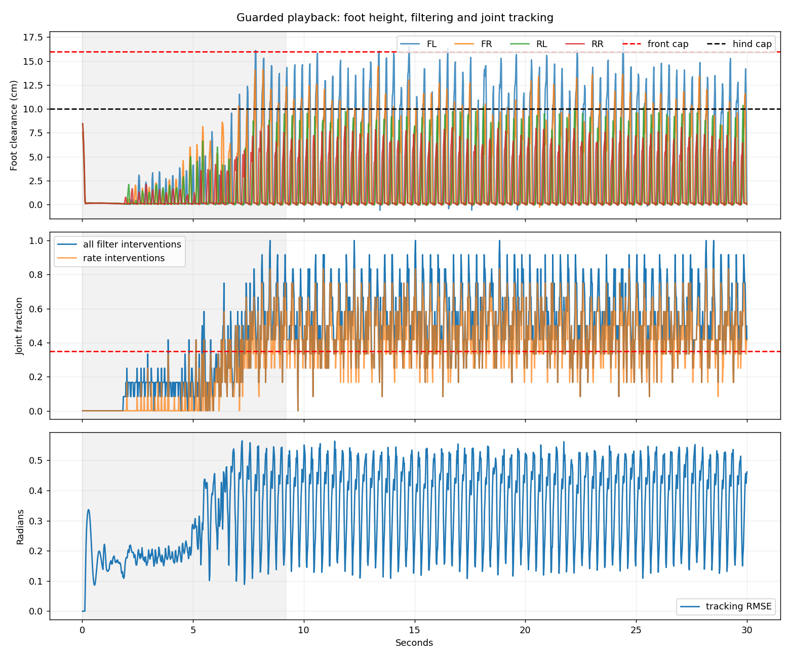

# 2.5m/s·발 높이·강한 관절 제한 학습 결과 — 2026-11-03

**발 높이 감소와 관절 명령 제한은 확인됐다. 전체 갤롭 조건은 아직 미달이다.** 30초 플레이에서 낙상 없이 목표2.5m/s에 실제 평균2.49m/s로 움직였고, 앞발 최대 높이는 직접 부모의32.7→17.2cm, 뒷발은11.6→10.4cm로 낮아졌다. 명령 각도·변화 속도 상한도 지켰다. 다만 안정 착지68.3%, 앞발 지지폭 유지71.7%, 필터 개입53.5%가 기준에 못 미쳤다.

이번 작업은 기존 학습·플레이 파일 분석만 수행했다. PPO/모방 optimizer 갱신0, 새 물리 시뮬레이션0이며 정책·보상·설정·모델·원본 로그는 보존했다. 새 모델의 MuJoCo Sim2Sim은 미검증이다.

## 모델·실행·영상

| 항목 | 결과 |
|---|---|
| 학습 실행 | `20261103_151318_e95d61` |
| 최종 정책 | [model_final.pt](../../runs/isaac/train/unitree_go2_gallop/20261103_151318_e95d61/model_final.pt) |
| SHA256 | `70ca957fb986b4c04538eea1a78e053db0f1782746ca8ba3311eb7b5578aee92` |
| 부모 | 모방 전22,000회 `20261102_161522_fe6276/model_final.pt` |
| 학습량 | 추가PPO2,000회 / 12,288,000 transition / 새 분기 누적24,000회 |
| 모방 학습 | 없음. 기존 bounded24,000회 정책과 다른 분기 |
| 완료 | 2026-11-03 15:46:50 KST, 로그 기준2,007.45초 |
| 인터페이스 | guarded v4 / actor49·critic64·관절12·scale0.5 |
| 목표 | 정지→일반 보행→갤롭2.5m/s 고정, 도약14cm·60ms |
| 사용자 플레이 | `20261103_160608_cf586d`, 1,500step/30초, 자연timeout/낙상0 |
| 플레이 영상 | [29.98초 MP4](../../runs/isaac/play/unitree_go2_gallop/20261103_160608_cf586d/videos/gallop-play-step-0.mp4) |
| 실제 영상 수 | 학습0개 / 플레이1개. [목록](videos.csv) |

손실 iteration0~1999, 최종 체크포인트iter1999/status2,000회가 모두 있어 학습 완료다. 평균 리워드1995개는 첫5회에 완료 episode가 없었던 결과다. 최근100회 평균 리워드는280.72이며 비용과 물리 조건이 달라 이전 리워드와 단순 비교하지 않는다.

## 비교 기준

직접 부모는 [모방 전22,000회 결과](../20261103_gallop_stabilization_review/README.md)이며, 직전 실험은 [bounded24,000회 결과](../20261103_gallop_bounded_review/README.md)다. 현재는 부모22,000회에서 직접 이어 학습했다. 부모/직전 실험은 명령2.2m/s, 현재는2.5m/s이며 물리 제한·보상·실행 필터도 달라 개별 변경의 인과 효과를 분리한 실험은 아니다.

현재 갤롭 전환 완료는8.18초다. 공식 계측은 **9.20~30초 / 1,041표본 / 20.82초**, 도약은5ms 물리 표본6,000개로 추적했다. 아래 수치는 별도 표시가 없으면 공식 구간이다.

| 항목 | 직접 부모22,000회 | 직전 bounded24,000회 | 현재 guarded24,000회 |
|---|---:|---:|---:|
| 전진 명령 | 2.2m/s | 2.2m/s | 2.5m/s |
| 실제 몸체 전진속도 | 2.425m/s | 2.311m/s | 2.489m/s |
| 앞발 최대 높이 | 32.7cm | 37.0cm | 17.2cm |
| 뒷발 최대 높이 | 11.6cm | 11.8cm | 10.4cm |
| 목표 변화 속도95백분위 | 37.4rad/s | 42.6rad/s | 16.0rad/s |
| 실제 관절 추종 RMSE | 0.530rad | 0.540rad | 0.390rad |
| roll RMS | 3.93° | 2.86° | 1.33° |
| pitch RMS | 3.13° | 3.17° | 3.47° |
| yaw 각오차 RMS | 2.16° | 4.92° | 1.06° |
| 최대 횡편차 | 0.723m | 3.557m | 0.549m |
| 평균 도약거리 | 17.37cm | 15.99cm | 17.41cm |
| 안정 회복 | 57/59, 96.61% | 55/59, 93.22% | 41/60, 68.33% |
| 앞발 지지폭24~30cm 유지율 | 82.62% | 99.00% | 71.73% |
| 뒷발 지지폭 유지율 | 78.13% | 90.29% | 95.72% |

몸체 고정 roll 편향은 줄었지만 roll 시간변화율RMS는0.319→0.652rad/s로 증가했다. 모든 진동과 착지까지 안정화됐다고 판단하지 않는다. 공식 구간 횡변위−0.573m, 전체 초기 진행선 대비 최대 횡편차0.549m이므로 완전 직선 이동으로 단정하지 않는다.

## 발 높이

| 발 | 기준 높이 | 95백분위 | 최대 |
|---|---:|---:|---:|
| FL | 16cm | 14.26cm | 17.19cm |
| FR | 16cm | 11.01cm | 14.47cm |
| RL | 10cm | 8.85cm | 10.37cm |
| RR | 10cm | 6.98cm | 8.18cm |

성공 판정의1mm 여유를 포함한 높이 초과 비율은 앞발 쌍 평균0.192%, 뒷발0.144%로 각각10% 기준을 통과했다. 높이는 패널티 조건이며 절대 상한은 아니므로 최대값이16/10cm를 조금 넘은 사실도 기록한다. 공중기 포함 주기는59/59로 발을 낮추는 과정에서 공중기가 사라진 상태는 아니다. 앞다리 하중37.62%/각 최소16.49%, 운동·주기 참여 조건도 통과했다.

## 관절 제한과 실제 초과

원본 모델 가동범위의 중앙90%를 물리 시뮬레이터 제한으로, 그 안쪽5% 여유를 둔 중앙81%를 실행 목표 범위로 사용했다. 이 값은 학습 manifest의 실제 관절 계약과 대조했다. 원본 USD는 보존돼 있다.

- 실행 목표각의 작업/물리 범위 이탈: **0%**.
- 명령 변화 속도 상한 위반: **0%**. hip6rad/s, thigh/calf16rad/s이며 수치 비교 허용오차2e-4rad/s를 사용했다. 이는 실제 관절 속도와 구분한다.
- 원래 기계적 범위 이탈: **0%**.
- 좁힌 물리 경계의 실제 최대 초과: **0.0010025rad, 약0.0574°**. 설정된 감시 허용오차0.01rad보다 작고 지속 초과 시간은0이었다.
- 0.001rad보다 큰 작은 solver 초과는 전체 관절 표본의0.0080%였다. 실제 각도가 수학적으로 한 번도 경계를 넘지 않았다고 보고하지 않는다.

이전 모델의 같은90% 범위 최대 초과 약9.94°/10.52°보다 작아졌다. 현재 실제 관절 추종 RMSE는0.390rad(22.32°)로 부모0.530rad(30.39°)보다 줄었지만, 목표각을 즉시 완전히 추종한다는 의미는 아니다.

## 정책 자체의 제약 적응은 아직 미달

제한 전 요청 중 물리 각도 범위를 벗어난 비율은5.71%로 기존10% 기준 이내다. 하지만 작업 여유폭·명령 속도까지 포함한 필터 개입은 **53.51%**로35% 기준을 넘었다. 명령 속도 제한에 해당하는 개입은45.34%다. 두 비율은 중복될 수 있어 더하지 않는다. 요청과 실행 목표의 RMS 차이는0.137rad다.

최종 목표가 안전 범위에 있다는 사실과 정책이 필터에 덜 의존한다는 조건은 다르다. 현재 `guarded_limits` 실패는 이번 플레이에서 실제 관절 감시 허용오차를 넘어서가 아니라 **필터 개입 비율이 높아서** 발생했다. 단순히 제한을 풀어 성공률을 높이는 방식으로 해결하지 않는다.

## 도약·착지·발폭과 전체 판정

도약60회, 평균17.41cm/최대21.47cm, 평균 공중시간74.58ms다. 모두14cm·60ms를 충족했다. 안정 회복41회/회복 중단19회, 거리·시간·안정 회복 동시 충족41회다. 회복 중단19회는 낙상19회가 아니다. 실제 episode는 낙상 없이30초 자연timeout으로 끝났다. 거리 보상은59.05점이며 보상 예산·앞다리 자격·확정 조건이 있어 거리 충족 횟수와 보상 횟수는 동일하지 않다.

착지 안정 비율68.33%는80% 기준에 미달했다. 기록된 착지 충격 최대1.27배 체중과 하강 속도0.650m/s는 각각3배/1.2m/s 기준 이내지만, 원시5ms 발속도와 각 회복 중단 사유가 없어 미끄러짐·지지 이탈 등 원인을 전부 분리할 수 없다.

앞발 양발 지지 평균폭은24.47cm, 허용24~30cm 유지율274/382=71.73%로80%에 미달했다. 뒷발은28.09cm/515/538=95.72%로 통과했다. 앞발의 전체 구간 평균폭이 목표에 가까워도 지지 중 유지율까지 충족한 것은 아니다.

전체 실패 항목은 **stable, stabilization_width, stabilization_landing, guarded_limits**다. 추종·패턴·공중기·ROM·앞다리 참여·자세·도약거리·발 높이 조건은 통과했다. 개별 착지 순서는 느슨하게 설정돼 있어 낮은 strict order 정확도를 실패 원인으로 삼지 않는다.

## 학습 중 재현성

적격 학습 episode10,086개/충분한 공식 계측7,210개, 전체 성공0개다. 최근1,000 iteration의5,048개에서 추종73.22%, 공중기30.67%, 발폭1.43%, 착지 안정0%, 제약 적응0%였다. 최근200회에서 공중기는44.08%까지 올라갔지만, 공식 계측이 있는796개의 필터 개입 중앙값은60.81%로 기준을 넘었다.

충분한 공식 계측이 있는7,210개 중7개에서 실제 초과 허용오차0.01rad를 넘는 표본이 기록됐다(최근200회는796개 중2개). 이 집계는 공식 갤롭 구간에 한정하며, 계측 전 종료된 episode의 원인을 모두 설명하지 않는다. 최근200회 실제 실패 종료 비율은23.40%였지만 종료 사유별 원시 항목이 없어 모두 관절 제한 때문이라고 단정하지 않는다.

속도는2.5로 고정됐다. 판단48회는 대기1/유지47, 승급0이며 반복 성공이 없어 `highest_confirmed_speed=null`이다. 학습 중 확률적 행동·환경 변화 집계와 결정론적 단일 플레이를 구분한다.

## 다음 작업과 증거

다음 검토 대상은 **착지 회복, 앞발 지지폭, 필터 의존도**다. 발 높이·관절 제한은 유지하면서 이 항목을 함께 개선해야 한다. 이번 수집에서는 보상·정책·설정을 변경하거나 추가 학습하지 않았다.

- [수집 요약·완료 근거](summary.json), [영상 목록](videos.csv), [갤롭 프레임](gallop_keyframes.png)
- [발 높이·관절 제약 검증](guarded_play_diagnostics.json), [학습 중 제약 통계](guarded_training_diagnostics.json), [관절별 CSV](guarded_joint_diagnostics.csv)
- [도약 사건 CSV](play_flight_events.csv), [도약·회복 진단](play_diagnostics.json), [성공 gate](stabilization_diagnostics.json)
- [자세·방향·발폭](heading_play_diagnostics.json), [추종 그래프](bounded_joint_tracking.png), [학습 곡선](training_curves.png)
- [무결성·수식 검증](verification.json), [원본 해시](evidence_manifest.json), [추가 비교 입력 해시](additional_input_manifest.json), [분석 소스·문서·산출물 해시](collection_manifest.json)
