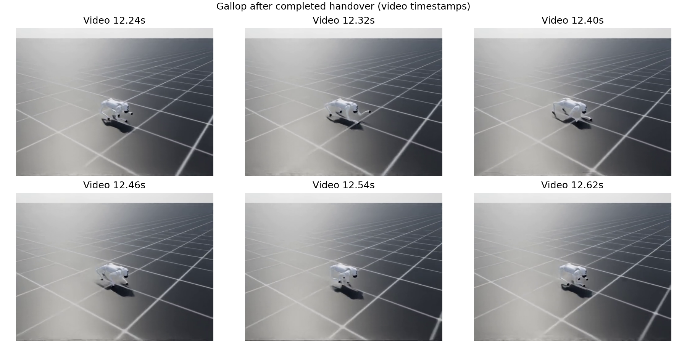
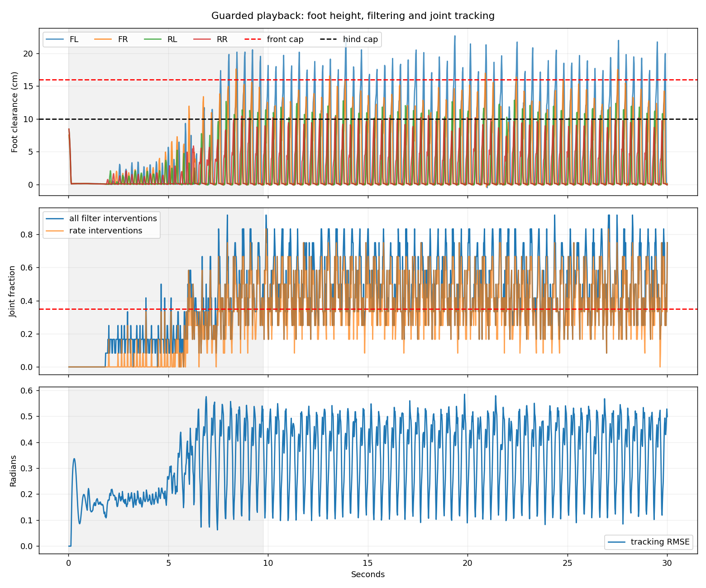

# 3.0m/s·22cm 목표 추가 학습 결과 — 2026-11-03

**평균 도약은17.4→18.6cm로 소폭 늘었지만, 앞발 지지폭과 착지 안정성은 개선되지 않았다.** 추가2,000회 학습은 정상 완료됐으나 전체 성공0으로 승급하지 못했다. 최종 설정 목표는3.0m/s·22cm이며, 실제 학습·플레이 단계는 **명령2.5m/s·도약 기준14cm**였다. 이번 플레이의 실제 전진 속도는2.44m/s이고22cm 이상 도약은0회다.

이번에는 사용자 완료 학습과 플레이 파일만 수집했다. 추가 PPO/모방 optimizer 갱신0, 새 물리 주행0이며 정책·보상·설정·원본 로그를 보존했다. 새26,000회 정책의 MuJoCo Sim2Sim 성능은 미검증이다.

## 모델과 영상

| 항목 | 기록 |
|---|---|
| 학습 실행 | `20261103_165217_19801a` |
| 정책 | [model_final.pt](../../runs/isaac/train/unitree_go2_gallop/20261103_165217_19801a/model_final.pt) |
| SHA256 | `57607c19b9635ef21567e7a90fdbe75acce1cab532b9f78a44637a937696939d` |
| 직접 부모 | guarded24,000회 `20261103_151318_e95d61/model_final.pt` |
| 학습량 | 추가PPO2,000회 / 새12,288,000 transition / 계보26,000회 |
| 완료 | 2026-11-03 17:24:03 KST / 실행 로그1,901.61초 |
| 인터페이스 | guarded v4 / actor49·critic64·관절12·scale0.5 / 추가 모방 없음 |
| 플레이 | `20261103_173835_024b20`, 1,500step/30초 / 낙상0·자연timeout |
| 영상 | [29.98초 MP4](../../runs/isaac/play/unitree_go2_gallop/20261103_173835_024b20/videos/gallop-play-step-0.mp4) |
| 영상 수 | 학습 영상0개 / 플레이 영상1개 |

체크포인트 iter1999·status의PPO2,000회·TensorBoard value loss의0~1999 iteration을 대조해 완료를 확인했다. reward scalar는1995개로, 첫5회에 완료 episode 평균이 없는 것은 학습 누락이 아니다. 최근100회 mean reward는339.61이지만 가중치를 바꿨으므로 부모의280.72와 직접 성능 순위를 매기지 않는다.

## 직접 부모와 비교

양쪽 모두 명령2.5m/s인 결정론적 단일 플레이다. 현재 정지→보행→갤롭 전환 완료는8.74초, 공식 갤롭 분석은9.76~30초/1,013표본/20.26초다. 부모는9.20~30초/1,041표본이다. 아래 자세·속도·발 높이·폭은 각 공식 구간, 도약은5ms tracker의 사건 통계다. 주기와 보상 가중치가 함께 달라 단일 변경의 인과 효과로 해석하지 않는다.

| 항목 | 부모24,000회 | 현재26,000회 |
|---|---:|---:|
| 명령 속도 | 2.50m/s | 2.50m/s |
| 실제 전진 속도 | 2.489m/s | 2.441m/s |
| 전진 추종 RMSE | 0.165m/s | 0.179m/s |
| 평균 도약 | 17.41cm | 18.57cm, 약6.6% 증가 |
| 최대 도약 | 21.47cm | 21.38cm |
| 평균 공중시간 | 74.58ms | 81.73ms |
| 안정 착지 | 41/60, 68.33% | 34/52, 65.38% |
| 앞발 양발 지지 평균폭 | 24.47cm | 22.85cm |
| 앞발 폭24~30cm 유지율 | 71.73% | 21.78% |
| 뒷발 양발 지지 평균폭 | 28.09cm | 26.41cm |
| 뒷발 폭 유지율 | 95.72% | 98.09% |
| 앞발 최대 높이 | 17.19cm | 22.66cm |
| 뒷발 최대 높이 | 10.37cm | 12.85cm |
| 관절 필터 개입 | 53.51% | 50.01% |
| 관절 추종 RMSE | 0.390rad | 0.385rad |
| roll / pitch RMS | 1.33° / 3.47° | 1.82° / 1.91° |
| roll / pitch 변화율 RMS | 0.652 / 0.460rad/s | 0.700 / 0.530rad/s |
| yaw각 RMS | 1.06° | 1.54° |
| 초기 진행선 대비 최대 횡편차 | 0.549m | 0.751m |

pitch 자세 오차는 줄었지만 roll·yaw·시간 변화율은 모두 개선됐다고 말할 수 없다. 현재 공식 구간의 월드Y 변위는−1.462m이며, 구간 시작은 초기 진행선의+0.712m, 끝은−0.751m다. 몸체 기준 속도 추종 통과와 월드 직진 오차를 구분한다.



## 도약과 착지

도약52회 중51회가 **실제 활성 기준14cm·60ms**를 충족했다. 거리 최솟값13.66cm, 평균18.57cm, 최댓값21.38cm다. 최종 목표22cm 이상은0회다. 안정 회복34회/회복 중단18회, 거리·시간·안정 회복 동시 충족34회다. 공중기 포함 주기는51/51로 통과했다.

회복 중단18회는 낙상18회를 의미하지 않는다. episode는30초 동안 낙상 없이 끝났으나, 안정 착지율65.38%는80% 기준보다 낮다. 최대 착지 충격1.48배 체중·하강 속도0.720m/s는 설정 상한3배·1.2m/s 이내다. 원시5ms 발속도와 회복 중단 사유 코드가 없어 각 중단을 미끄러짐·접지 이탈 등으로 완전히 분류할 수 없다.

거리 보상72.22점은 가중치4와 안정 회복 품질·주기별 보상 예산을 포함한다. 부모는 가중치3이었으므로 보상 총점 증가를 도약 성능 증가율로 해석하지 않는다. 도약 평균 증가와 최대값 미증가를 함께 기록한다.

## 앞발 지지폭과 높이

앞발은 양발 지지381표본 중83개만24~30cm 안에 들어 **21.78%**로 실패했다. 목표26.98cm보다 지지 평균22.85cm가 좁다. 뒷발은523표본 중513개/98.09%로 통과했다. 앞다리 하중39.47%/개별 최소16.69%와 운동·주기 참여는 통과하므로 앞다리를 전혀 사용하지 않는 상태는 아니다.

| 발 | 높이 패널티 기준 | 높이95백분위 | 최대 | 기준+1mm 초과율 |
|---|---:|---:|---:|---:|
| FL | 16cm | 18.02cm | 22.66cm | 11.35% |
| FR | 16cm | 13.52cm | 17.53cm | 0.59% |
| RL | 10cm | 10.85cm | 12.85cm | 7.31% |
| RR | 10cm | 9.04cm | 10.81cm | 0.89% |

현재 높이 성공 판정은 앞/뒤 각 **두 발 평균** 초과율을 사용한다. 앞5.97%/뒤4.10%로10% 기준을 통과했지만, FL 개별 초과율은11.35%다. `guarded_feet=true`를 네 발이 각각 기준 이내였다는 뜻으로 해석하지 않는다. 높이 제한은 비용이며 절대 위치 상한이 아니다.

## 관절 제한과 필터 적응

실행 목표각의 작업 범위·물리 범위 이탈과 명령 변화 속도 상한 위반은0%다. 원래 기계적 관절 범위 이탈도0%다. 좁힌 물리 경계의 실제 최대 초과는0.002980rad/약0.171°로 설정 감시 허용오차0.01rad 이내였고, 지속 초과 시간은0이었다. 1mrad보다 큰 초과는 관절 표본의0.0247%로, 수학적 실제 초과0이라고 보고하지 않는다.

제한 전 요청각 초과율은5.36%로 기존10% 기준 이내지만, 목표 여유폭·변화 속도까지 포함한 필터 개입은50.01%로35% 기준을 넘었다. 속도 제한 개입은42.23%이며 중복될 수 있어 두 비율을 더하지 않는다. 요청-실행 RMS 차이는0.130rad다. 이번 플레이의 `guarded_limits` 실패 원인은 실제 감시 허용오차 초과가 아닌 높은 필터 개입이다.



## 승급하지 못한 이유와 학습 중 재현성

전체 실패 항목은 **stable, stabilization_width, stabilization_landing, guarded_limits**다. 충분한 계측·추종·패턴·공중기·운동·앞다리 참여·자세·활성 도약거리·발 높이 쌍 평균은 통과했다. 느슨하게 둔 개별 착지 순서를 승급 실패 원인으로 삼지 않는다.

적격 학습 episode9,778개/충분 계측7,783개에서 전체 성공0개였다. 최근1,000회5,008개의 추종 통과79.33%, 공중기75.08%, 발폭3.04%, 착지 안정0.12%, 관절 필터 적응0%다. 공중기 통과는 부모의30.67%보다 늘었지만 나머지 필수 조건을 모두 만족한 episode는 없었다.

최근200회997개 중 충분 계측822개에서 필터 개입 중앙값58.28%였고, 실패 종료 비율은전체997개 기준18.15%였다. 공식 계측 중 실제 감시 허용오차 초과가 기록된 것은 전체2/7,783개, 최근200회0/822개다. 계측 전 조기 종료의 원인을 이 집계로 모두 설명하지 않는다. 확률적 학습 집계와 결정론적 단일 플레이 결과는 구분한다.

curriculum 판단48회는 대기1/유지47, 승급0이었다. 따라서 최종3.0m/s·22cm가 설정돼 있어도 **실제 전진 명령과 도약 기준은 계속2.5m/s·14cm**였다. 주기·가중치 변경은 적용됐지만22cm 기준으로 승급해 학습한 정책은 아니다. `highest_confirmed_speed=null`이며 안정성 기준을 통과했다고 표시하지 않는다.

다음 검토 대상은 앞발 지지폭과FL 발 높이, 착지 회복, 필터 의존도다. 이번 수집에서는 이 조건을 낮추거나 추가 학습하지 않았다.

## 증거와 재현

- [완료·모델·학습·플레이 요약](summary.json), [부모 비교 수치](guarded_parent_comparison.json), [영상 목록](videos.csv)
- [도약52회 사건 CSV](play_flight_events.csv), [도약·회복 진단](play_diagnostics.json), [성공 판정](stabilization_diagnostics.json)
- [제약·높이 독립 계산](guarded_play_diagnostics.json), [학습 중 제약 통계](guarded_training_diagnostics.json), [관절별 CSV](guarded_joint_diagnostics.csv)
- [자세·방향·접촉별 발폭](heading_play_diagnostics.json), [학습 곡선](training_curves.png)
- [37항목 검증](verification.json), [검증 소스](source/verify.py), [원본 해시](evidence_manifest.json), [분석·문서·산출물 해시](collection_manifest.json)

```bash
cd /home/cvr/GH/go2_animalization/gallop
OPENBLAS_NUM_THREADS=1 OMP_NUM_THREADS=1 MKL_NUM_THREADS=1 \
  .venv/bin/python reports/20261103_gallop_guarded_3mps_leap_review/source/verify.py
```
