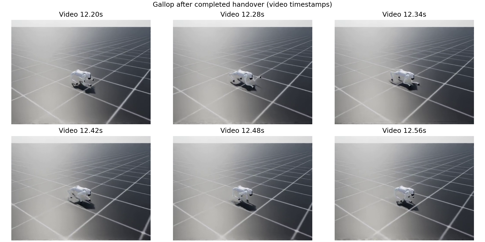
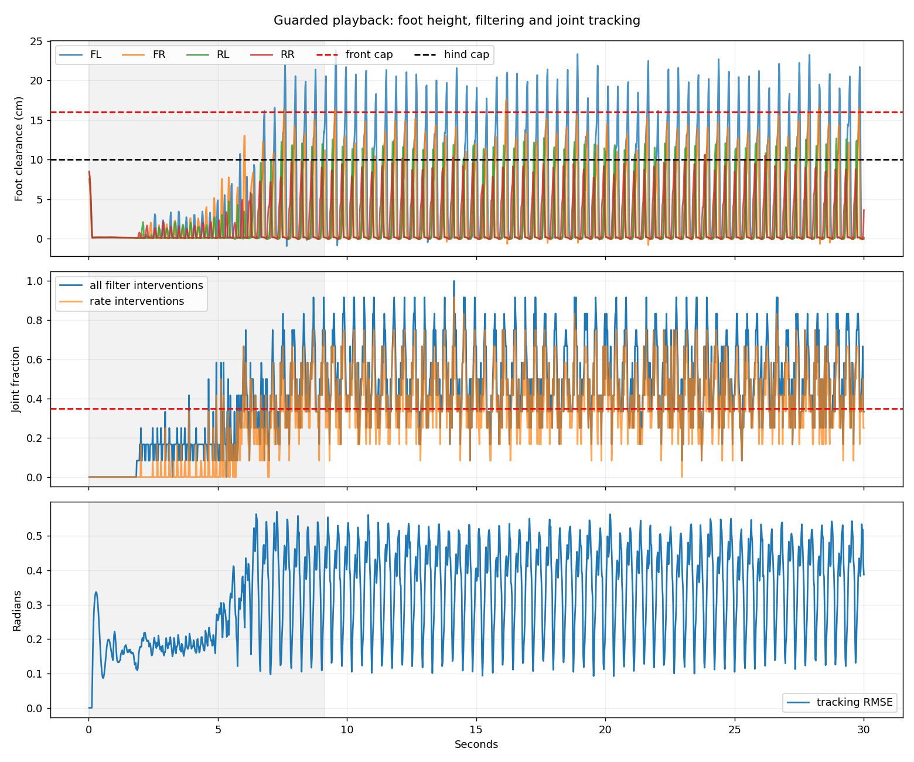

# 안정성 가중치 강화 추가 학습 결과 — 2026-11-03

**앞발 간격 유지율은21.8→64.1%로 개선됐지만, 전체 안정성 조건은 여전히 미달이다.** 실제 전진 속도2.45m/s·30초낙상0을 확인했다. 안정 착지는65.4→66.0%로 소폭 상승했고, 평균 도약은18.6→17.5cm로 줄었다. 앞발 최대높이23.83cm와 관절 필터 개입50.89%는 남은 문제다.

추가PPO2,000회/계보28,000회 학습은 정상 완료됐다. 전체 성공0/승급0으로 실제 학습 단계는 **명령2.5m/s·도약 기준14cm**다. 최종 설정 목표3.0m/s·22cm와 달성값을 구분한다. 이번 수집에서 추가 학습·모방 갱신·새 물리 주행은0회이며, 새28,000회 정책의 MuJoCo Sim2Sim 성능은 미검증이다.

## 모델·학습·영상

| 항목 | 기록 |
|---|---|
| 학습 실행 | `20261103_191405_bea09f` |
| 최종 정책 | [model_final.pt](../../runs/isaac/train/unitree_go2_gallop/20261103_191405_bea09f/model_final.pt) |
| SHA256 | `dc129d38e78654a6559657740b7a46865830ca3cefcf06c908f49cdcef53fea7` |
| 직접 부모 | guarded26,000회 `20261103_165217_19801a/model_final.pt` |
| 학습량 | 추가2,000회 / 새12,288,000 transition / 계보28,000회 / 추가모방0 |
| 완료 | 2026-11-03 19:43:18 KST / 로그1,746.84초 |
| 인터페이스 | guarded v4 / actor49·critic64·관절12·scale0.5 |
| 적용 설정 | `gallop_guarded_stability.json` / 발폭 가중치7·높이3.5·착지4 |
| 플레이 | `20261103_194343_6d76b6`, 1,500step/30초 / 낙상0·자연timeout |
| 플레이 영상 | [29.98초 MP4](../../runs/isaac/play/unitree_go2_gallop/20261103_194343_6d76b6/videos/gallop-play-step-0.mp4) |
| 영상 수 | 학습0개 / 플레이1개 |

체크포인트 iter1999·status의PPO2,000회·TensorBoard loss의0~1999 iteration을 대조했다. reward scalar는1995개로 첫5회에 완료 episode 평균이 없을 뿐이다. 최근100회 mean reward는382.86이지만, 가중치를 바꾼 부모의339.61과 직접 성능 순위를 매기지 않는다.

## 직접 부모와 비교

양쪽 모두 명령2.5m/s·동일한 참조 주기이며 가중치7개만 달라진 모델이다. 서로 다른 결정론적 단일 episode로, 단일 보상의 인과 효과나 다중 seed 성공률을 확정하지 않는다. 현재 갤롭 전환은8.10초, 공식 분석 구간은9.12~30초/1,045표본/20.90초다. 부모 공식 구간은9.76~30초/1,013표본이다.

| 항목 | 부모26,000회 | 현재28,000회 |
|---|---:|---:|
| 실제 전진 속도 | 2.441m/s | 2.455m/s |
| 전진 추종 RMSE | 0.179m/s | 0.167m/s |
| 평균 도약 | 18.57cm | 17.51cm |
| 최대 도약 | 21.38cm | 20.72cm |
| 평균 공중시간 | 81.73ms | 76.57ms |
| 안정 착지 | 34/52, 65.38% | 35/53, 66.04% |
| 앞발 양발 지지 평균폭 | 22.85cm | 24.42cm |
| 앞발 폭24~30cm 유지율 | 21.78% | 64.10% |
| 뒷발 양발 지지 평균폭 | 26.41cm | 26.53cm |
| 뒷발 폭 유지율 | 98.09% | 98.23% |
| 앞발 최대 높이 | 22.66cm | 23.83cm |
| 뒷발 최대 높이 | 12.85cm | 12.74cm |
| 제한 전 요청각 초과 | 5.36% | 6.32% |
| 관절 필터 전체 개입 | 50.01% | 50.89% |
| 명령 속도 제한 개입 | 42.23% | 42.23% |
| 관절 추종 RMSE | 0.3851rad | 0.3838rad |
| roll / pitch RMS | 1.82° / 1.91° | 1.68° / 1.87° |
| roll / pitch 변화율 RMS | 0.700 / 0.530rad/s | 0.716 / 0.524rad/s |
| yaw각 RMS | 1.54° | 1.38° |

각도 편향은 소폭 줄었지만 roll 변화율은 증가했다. 몸체z 각속도 RMS도0.168→0.189rad/s로 늘어 모든 진동이 줄었다고 해석하지 않는다.

초기 진행선 대비 최대 횡편차는0.751→0.974m다. 현재 공식 구간 시작부터 이미+0.971m 오프셋이 있었고 끝은+0.192m, 공식 구간Y 변위는−0.779m였다. 따라서 최대 편차 증가만으로 갤롭 구간의 횡방향 이동이 모두 악화됐다고 결론내리지 않는다. 월드 횡속도 RMS는0.0856→0.0668m/s로 줄었다.



## 도약과 착지 사건

5ms tracker는54회의 비행 사건을 기록했다. 그중52회가 실제 활성 기준14cm·60ms를 충족했고, 거리·시간·안정 회복 동시 충족은35회다. 최대20.72cm로 최종 목표22cm 충족은0회다. 공중기 포함 참조 주기는52/52, 앞다리 하중39.26%/개별 최소16.83%로 기존 참여 조건을 통과했다.

안정 회복35회/회복 중단18회다. **안정 착지율 분모는 회복 평가에 선택된53회**이므로35/53=66.04%이며35/54가 아니다. 나머지1회는15.22초에 기록된 공중5ms·거리1.26cm 사건으로 회복 평가에 선택되지 않았다. 종료 시 미완료 회복은 없었다. 이 짧은 사건을 제외한 평균 거리도 약17.82cm로 부모18.57cm보다 작다.

회복 중단18회는 낙상18회가 아니다. 최대 착지 충격1.59배 체중·하강 속도0.724m/s는 설정 상한3배·1.2m/s 이내지만, 원시5ms 발속도와 회복 중단 사유 코드가 없어 중단 원인을 전부 분리할 수 없다. 도약 보상은71.99점이며 주기별 예산·앞다리 자격·회복 확정을 포함하므로 충족 사건 횟수와 같지 않다.

## 발 간격과 높이

앞발 양발 지지390표본 중250개가24~30cm 안에 들어64.10%로 개선됐다. 평균24.42cm는 목표26.98cm보다 좁고 유지율도80% 기준에는 미달했다. 뒷발은564표본 중554개/98.23%로 통과했다.

| 발 | 높이 비용 기준 | 높이95백분위 | 최대 | 기준+1mm 초과율 |
|---|---:|---:|---:|---:|
| FL | 16cm | 19.78cm | 23.83cm | 12.06% |
| FR | 16cm | 13.52cm | 17.59cm | 0.57% |
| RL | 10cm | 11.29cm | 12.74cm | 8.80% |
| RR | 10cm | 8.60cm | 10.58cm | 0.38% |

높이 비용을 소폭 올렸지만FL 높이는 줄지 않았다. 높이는 패널티 기준이므로 절대 위치 상한은 아니다. 높이 성공 판정은 앞/뒤 각각 두 발 평균을 사용해 앞6.32%·뒤4.59%로10% 기준을 통과했지만, FL 개별 초과율은12.06%다. `guarded_feet=true`를 모든 발이 개별 기준을 충족했다는 의미로 해석하지 않는다.

## 클리핑과 관절 제약

제한 전 정책 요청각 중 물리 범위 초과는6.32%다. 목표각 여유폭·변화 속도 제한까지 포함한 전체 필터 개입은50.89%로35% 기준을 넘었다. 속도 제한 개입42.23%와 중복되므로 더하지 않는다. 필터가 바꾼 요청의 비율은 줄지 않았지만 요청-실행 RMS 차이는0.130→0.121rad, 같은 공식의 투영 비용은0.1406→0.1266으로 감소했다. 보정 빈도와 보정 크기를 구분한다.

실행 목표각의 작업 범위·물리 범위 이탈과 명령 변화 속도 상한 위반은0%다. 원래 기계적 관절 범위 이탈도0%다. 좁힌 물리 경계의 실제 최대 초과는0.003532rad/약0.202°로 감시 허용오차0.01rad 이내였고 지속 초과 시간0이다. 1mrad 초과는 관절 표본의약0.0080%이며 실제 각도의 수학적 경계 초과0으로 보고하지 않는다.



## 학습 중 재현성과 승급

적격 학습 episode9,671개/충분 계측7,826개에서 전체 성공0개였다. 최근1,000회4,970개의 추종 통과80.62%, 공중기74.31%, 발폭1.37%, 착지 안정0.91%, 관절 필터 적응0%다. 부모의 발폭3.04%·착지0.12%와 비교하면 착지는 늘었지만, 플레이에서의 발폭 개선이 학습 집계 전반의 개선으로 확인된 것은 아니다.

최근200회1,031개 중 충분 계측834개에서 필터 개입 중앙값은57.48%로 기준35%를 넘었다. 해당1,031개의 실패 종료 비율은19.30%다. 충분한 공식 계측 중 실제 감시 허용오차 초과는 전체1/7,826개, 최근1,000회0/4,054개였다. 계측 전 조기 종료 사유를 이 집계로 모두 설명하지 않는다. 확률적 학습 집계와 결정론적 단일 플레이는 구분한다.

플레이의 실패 항목은 **stable, stabilization_width, stabilization_landing, guarded_limits**다. 추종·패턴·공중기·앞다리 참여·자세·활성 도약거리·발 높이 쌍 평균은 통과했다. 개별 착지 순서는 여전히 필수 조건이 아니다.

curriculum 판단48회는대기2/유지46, 승급0이었다. 따라서 명령2.5m/s·도약 기준14cm가 유지됐고 `highest_confirmed_speed=null`이다.3.0m/s·22cm를 달성한 정책으로 표시하지 않는다. 다음 검토 대상은 앞발 폭의80% 재현, FL 높이, 착지 회복, 높은 필터 개입이다. 이번 수집에서는 보상·정책·설정을 변경하거나 추가 학습하지 않았다.

## 증거와 재현

- [완료·학습·플레이 요약](summary.json), [직접 부모 비교](guarded_parent_comparison.json), [영상 목록](videos.csv)
- [도약54회 사건 CSV](play_flight_events.csv), [도약·회복 진단](play_diagnostics.json), [전체 성공 판정](stabilization_diagnostics.json)
- [독립 제약·높이 계산](guarded_play_diagnostics.json), [학습 중 제약 통계](guarded_training_diagnostics.json), [관절별 CSV](guarded_joint_diagnostics.csv)
- [방향·자세·접촉별 발폭](heading_play_diagnostics.json), [학습 곡선](training_curves.png)
- [40항목 검증](verification.json), [검증 소스](source/verify.py), [원본 해시](evidence_manifest.json), [비교 입력 해시](additional_input_manifest.json), [분석·문서·산출물 해시](collection_manifest.json)

```bash
cd /home/cvr/GH/go2_animalization/gallop
OPENBLAS_NUM_THREADS=1 OMP_NUM_THREADS=1 MKL_NUM_THREADS=1 \
  .venv/bin/python reports/20261103_gallop_guarded_stability_review/source/verify.py
```
