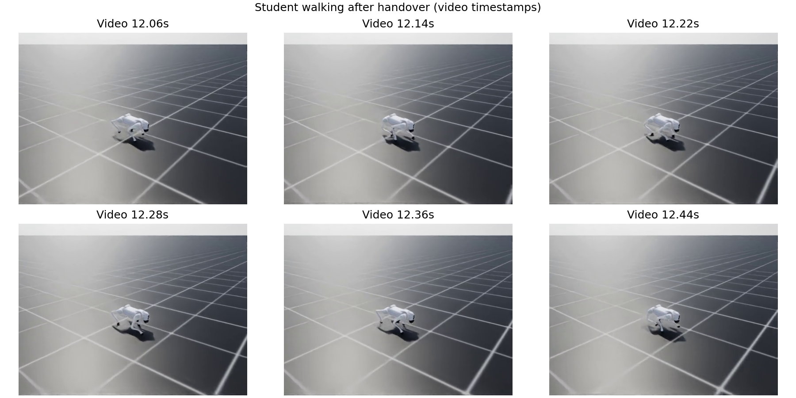
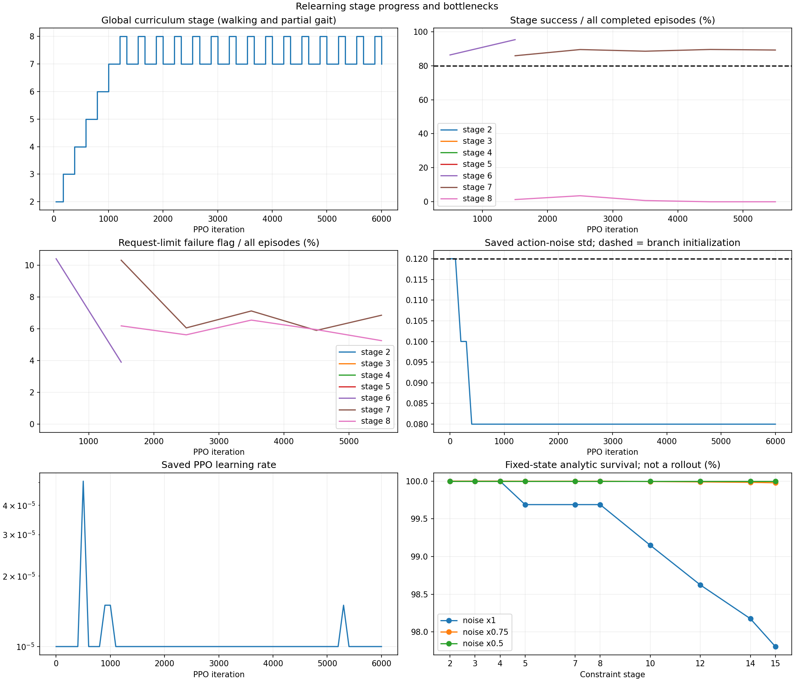

# 추가 6,000회 학습·플레이 종료와 결과 분석

**보행 제약 학습은 1.5m/s까지 진행됐지만, 첫 부분 갤롭 단계에서 앞다리 스윙 참여 조건을 통과하지 못해 보행 단계로 돌아왔다.** 최신 모델은 누적 22,000회다. 저장된 플레이는 평균 1.519m/s로 30초 동안 낙상 없이 보행했으며, 학생 제어 측정 구간의 요청각 초과 0%·속도 필터 개입 3.65%를 확인했다. 완전 갤롭 성공 결과는 아니다.

플레이 계산과 결과 저장은 이미 완료된 상태였다. 이후 Isaac 종료 정리 중 남은 프로세스를 종료했고, 영상·상태·메타데이터는 종료 전후 해시가 일치한다. 이번 작업은 기존 파일 분석과 프로세스 종료만 수행했다. PPO·모방 갱신과 새 물리 주행은 0이다.

## 모델과 영상

| 항목 | 결과 |
|---|---|
| 학습 실행 | `20261105_140131_620578` |
| 체크포인트 | [model_final.pt](../../runs/isaac/train/unitree_go2_gallop/20261105_140131_620578/model_final.pt) |
| SHA256 | `526f221fb8cb4897bbd5931b9575300d8803d2be4763361268128cbd73439207` |
| 학습량 | 추가 PPO 6,000회 / 36,864,000 transition / 이 분기 누적 22,000회 |
| 직접 부모 | 누적 16,000회 `20261104_144742_917f16/model_final.pt` |
| 학습 완료 | 2026-11-05 15:42:12 KST / 로그 6,035.92초, 약 1시간 40분 36초 |
| 저장된 단계 | 7단계 일반보행 1.5m/s / 갤롭 강도 0 |
| 학습 중 최고 단계 | 8단계 부분 갤롭 강도 0.25 / 완전 갤롭 미진입 |
| 플레이 | `20261105_154904_4a0e1e`, 1,500step / 30초 |
| 영상 | [MP4 원본](../../runs/isaac/play/unitree_go2_gallop/20261105_154904_4a0e1e/videos/gallop-play-step-0.mp4), 1,499프레임 / 29.98초 / 50fps / 640×480 |
| 영상 수 | 학습 영상 0 / 플레이 영상 1 |

## 종료 처리와 보존

15:51:39 KST에 `COMPLETED`가 기록됐고 MP4 마지막 프레임까지 읽을 수 있었다. 30초 상태 배열·에피소드·설정·소스를 포함한 19개 파일을 [별도 백업](../../runs/isaac/check/unitree_go2_gallop/20261105_160030_b93db2/preserved_play/)에 복사하고 모두 해시를 확인했다.

플레이 자식 PID 3565171과 대기 중인 런처 PID 3565169를 확인했다. 자식에게 16:00:44 SIGINT, 16:01:16 SIGTERM을 보냈지만 종료되지 않았다. 결과가 계속 백업과 일치하는지 다시 확인한 뒤 16:01:58 SIGKILL로 해당 자식만 종료했다. 런처도 함께 종료됐음을 확인했다. 다른 Isaac 프로세스는 종료하지 않았다.

[종료·보존 기록](shutdown_preservation.json)에는 신호 순서, 대상 실행 경로, 백업 파일 해시와 종료 후 확인 결과를 저장했다. 원래 `status.json`의 completed 상태는 결과 저장 완료를 뜻하며, 이번에 OS 프로세스가 스스로 정상 종료됐다는 뜻은 아니다.

소스에서 `COMPLETED` 이후에는 `video.close()`/`env.close()`와 `app.close()`가 실행된다. 따라서 이번 증거는 종료 정리 단계의 정체와 일치한다. 정체 당시 네이티브 스택을 확보하지 않아 어느 close 함수 내부인지는 확정하지 않았다. 프로세스 종료만 수행했으며 종료 코드나 학습 정책을 수정하지 않았다.

## 저장된 플레이

학생 제어 시작은 7.32초다. 준비 구간과 전환 직후 1초를 제외한 측정 구간은 8.34~30초, 1,084개 제어 표본·21.68초다. 기존 분석 파일의 `formal_gallop` 키는 이 구간을 뜻하지만 이번 결과는 일반보행이다.

| 항목 | 측정값 |
|---|---:|
| 전진 명령 / 실제 평균 속도 | 1.500 / 1.519m/s |
| 전진 속도 RMSE | 0.0746m/s |
| 측정 구간 X / Y 변위 | +32.907 / +0.090m |
| 전체 시작점 대비 최대 횡편차 | 0.371m |
| roll / pitch / yaw 각 RMS | 0.920° / 3.323° / 0.585° |
| roll / pitch 변화율 RMS | 0.145 / 0.118rad/s |
| 요청각의 물리·목표 작업 범위 초과 | 각각 0% |
| 실행 목표각·변화율 제한 위반 | 0% |
| 저장된 실제 관절각의 물리 범위 초과 | 0 |
| 필터 개입 | 3.6516%, 모두 목표각 변화율 관련 |
| 요청각과 실행 목표각 차이 RMSE | 0.00813rad |
| 실행 목표각과 실제 관절각 차이 RMSE | 0.26234rad |
| 앞/뒤 양발 지지폭 24~30cm 유지율 | 각각 100% |
| 앞/뒤 양발 지지 평균폭 | 27.05 / 26.29cm |
| 앞발 / 뒷발 최대높이 | 5.38 / 6.46cm |
| 앞다리 전체 하중 비중 | 53.22% |
| 요청각 종료 / 낙상 | 0 / 0 |
| 보행 단계 성공 / 완전 갤롭 성공 | 통과 / 미달 |
| 측정 구간 공중기·도약 사건 | 0 |

전체 30초에는 정지·동결 보행·혼합 전환도 포함된다. 이 전체 구간의 원시 요청각 물리 범위 초과 비율은 0.256%, 목표 작업 범위 초과 비율은 0.933%다. 학생 측정 구간의 0%와 혼동하지 않는다. 실행 필터는 모든 구간에서 작동했고 저장된 실제 관절각의 초과는 전체 구간에서도 0이었다. [단계별 안전 지표](phase_safety_diagnostics.json)를 보관했다. 초기 낙하의 비접지 구간은 갤롭 도약으로 세지 않는다.



## 학습 경향: 관절 제약 통과 후 앞다리 스윙에서 정체

에피소드 26,008개의 단계 성공을 독립 수식으로 대조하고, 저장된 에피소드로 curriculum 판단 144회를 재현했다. 새로운 평가 집단에서 채택된 에피소드 14,080개, 다른 세대라 제외된 8,704개, 같은 환경의 반복 완료라 제외된 3,224개를 구분했다.

| 단계 | 목표 | 전체 완료 수 | 단계 성공률 | 요청각 종료 비율 |
|---|---|---:|---:|---:|
| 2 | 1m/s, 0.06rad·40ms | 792 | 96.97% | 0.00% |
| 3 | 1m/s, 0.04rad·40ms | 1,018 | 97.25% | 0.29% |
| 4 | 1m/s, 0.02rad·40ms | 817 | 96.08% | 0.49% |
| 5 | 1m/s, 0.02rad·20ms | 826 | 90.92% | 4.84% |
| 6 | 일반보행 1.25m/s | 1,024 | 88.57% | 8.79% |
| 7 | 일반보행 1.5m/s | 13,615 | 88.53% | 7.26% |
| 8 | 1.5m/s, 갤롭 강도 0.25 | 7,916 | 1.11% | 5.91% |

표는 전체 완료 기준이다. 실제 단계 판단에는 환경마다 한 번씩 채택한 결과를 사용한다. 8단계의 판단용 3,840개에서는 19개 성공, 0.495%였다. 7단계는 판단용 7,680개에서 91.28%였다. 이전 실행의 전체 2단계 요청각 종료 비율 85.27%와 비교하면 같은 1m/s·0.02rad/20ms 조건을 새 5단계에서 통과했다. 정책·탐색·평가와 학습 시기가 함께 달라 단일 변경의 인과 효과를 분리한 비교는 아니다.

std는 초기 0.12에서 최종 0.08로 유지됐고 entropy 계수는 0이었다. 이전처럼 학습 중 std가 커지는 현상은 나타나지 않았다. 처음 부분 갤롭에 진입한 시점은 이번 추가학습 약 1,208 iteration이다. 이후 7→8 진입과 8→7 회귀를 각각 15회 반복했다. 매 8단계 체류는 제어 시간 60초, PPO 약 125회였다. 마지막 1,000회에서는 8단계 1,638개 에피소드의 성공이 0이었다.

8단계에서 가장 강하게 막힌 판정은 `front_cycle`이다. 각 앞다리가 한 참조 위상 주기 안에서 접지 60ms 이상, 발 높이 3.5cm 이상인 비접지 스윙 40ms 이상을 만족하고, 그 참여 주기가 각 앞다리의 전체 주기 중 70% 이상이어야 한다. 8단계 전체의 이 조건 통과율은 91/7,916, **1.15%**였다. 판단용 집단에서는 19/3,840, 0.495%로 전체 단계 성공 수와 같았다.

반면 8단계 전체에서 전진 추종 93.46%, 앞다리 하중 95.10%, 앞다리 ROM 94.87%, 접촉 일치율 0.5 이상 95.14%는 통과했다. 앞다리 하중 비중 중앙값도 53.07%다. 앞다리가 충분한 하중과 관절 움직임을 보이면서도, 정해진 주기 안에서 요구 높이와 시간의 스윙을 반복하지 못하는 것이 주된 판정 병목이다. 이 지표는 자연 보행 주기를 독립 검출한 것이 아니라 참조 위상 주기로 계산한다.



## 다음 수정 방향

관절 범위와 최종 갤롭 판정을 유지하면서, 일반보행 마지막 단계부터 앞발의 높이·스윙 시간을 미리 학습시키는 것이 다음 후보다. 부분 갤롭 초기의 앞다리 참여 요구도 현재 보행 수준에서 최종 70%까지 단계적으로 올리는 방식을 검토할 수 있다. 새 갤롭 단계는 한 번의 낮은 평가로 60초 만에 회귀하므로, 적응 시간을 확보하거나 연속 실패 확인을 추가할 여지도 있다. 이 변경들은 이번 수집에서 적용하지 않았다.

현재 모델은 관절 제약을 지키는 1.5m/s 보행 기준선으로 보존한다. 아직 완전 갤롭, 3m/s, 22cm 도약 또는 실기 배포 적합성을 확인한 모델은 아니다. 이번 모델의 MuJoCo Sim2Sim 성능도 미검증이다.

## 재현과 증거

- [43개 무결성·수식 검증](verification.json), [검증 코드](source/verify.py)
- [학습·영상·출처 요약](summary.json), [플레이 분석](play_analysis.json)
- [단계·평가 집단·경향](relearn_training_diagnostics.json), [앞다리 조건별 분석](relearn_gate_diagnostics.json)
- [관절·발 높이 독립 계산](guarded_play_diagnostics.json), [자세·진행 방향](heading_play_diagnostics.json)
- [종료·보존 기록](shutdown_preservation.json), [전체 원본 파일 해시](evidence_manifest.json)

분석기의 단계 복원과 평가 집단 재현을 이번 추가학습 형식에 맞게 확장했다. 이전 실행의 66,644개 에피소드·288회 판단도 재현해 기존 형식과 호환됨을 확인했다. 학습 코드·보상·설정·모델과 원본 실행 폴더는 변경하지 않았다.

```bash
cd /home/cvr/GH/go2_animalization/gallop
OPENBLAS_NUM_THREADS=1 OMP_NUM_THREADS=1 MKL_NUM_THREADS=1 \
  .venv/bin/python reports/20261105_gallop_recovery_review/source/verify.py
```
