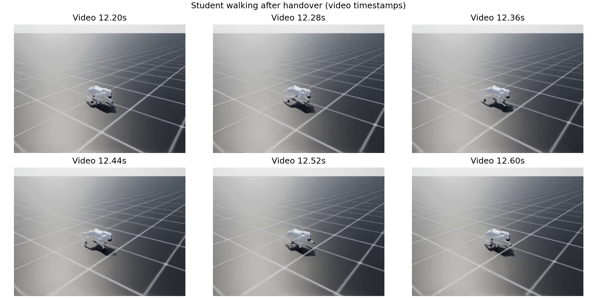
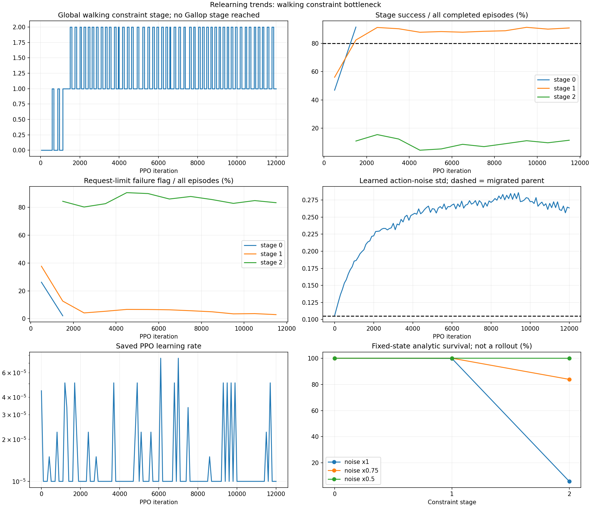

# 일반보행 기반 장기학습 수집·경향 분석 — 2026-11-05

**1m/s 보행의 평균 정책은 관절 범위를 잘 준수했지만, 종료 조건을 강화하는2단계에서 반복 회귀해 갤롭 학습에 진입하지 못했다.** 12,000회 학습은 정상 완료됐다. 플레이는 요청각 클리핑0%·전체 필터 개입8.52%·30초낙상0이었다. 학습 중에는1→2단계 승급과2→1단계 회귀를 각각46번 반복했다.

핵심 병목은 학습량보다 **탐색 분산과 종료 커리큘럼의 조합**으로 보인다. 보행1단계 성공률은 마지막1,000회에서90.94%까지 좋아졌지만,2단계는 같은 구간11.48%였다. 요청각 종료의 여유를0.06→0.02rad로 줄이면서 허용 지속시간도40→20ms로 동시에 줄였다. 탐색 noise std는 초기0.1052→최종0.2634로 약2.50배 커졌다. 이 관측은 단계 전환과 탐색 설정을 함께 수정할 근거이며, 특정 변경의 인과 효과를 분리한 재학습 실험은 아니다.

이번 작업은 저장된 파일 분석과 고정 상태의 확률 계산만 수행했다. 추가 PPO·모방 갱신0, 새 물리 주행0이며 학습 정책·보상·설정·원본 로그를 보존했다. 새 정책의 MuJoCo Sim2Sim 성능은 미검증이다.

## 모델·학습 완료·영상

| 항목 | 기록 |
|---|---|
| 학습 실행 | `20261104_144742_917f16` |
| 최종 정책 | [model_final.pt](../../runs/isaac/train/unitree_go2_gallop/20261104_144742_917f16/model_final.pt) |
| SHA256 | `959457e283918bcc480e71c1d6ce026cffb63feb5a1b9e0834b78f60f09a8200` |
| 직접 부모 | 전진1m/s 일반보행4,000회 `20261028_160258_54620c/model_final.pt` |
| 새 학습량 | PPO12,000회 / 73,728,000 transition / 새 분기 누적16,000회 |
| 완료 | 2026-11-04 17:42:11 KST / 로그10,463.28초, 약2시간54분 |
| 인터페이스 | relearn v5 / actor49·critic64·관절12·scale0.5 / 추가모방0 |
| 저장된 최종 단계 | 1단계 `walk_precision`, 명령1m/s·갤롭 강도0 |
| 도달한 최고 단계 | 2단계 `walk_limits`; 갤롭 강도는 전체 기간0 |
| 플레이 | `20261104_174822_1a4f51`, 1,500step/30초·자연timeout |
| 영상 | [29.98초 MP4](../../runs/isaac/play/unitree_go2_gallop/20261104_174822_1a4f51/videos/gallop-play-step-0.mp4) |
| 영상 수 | 학습0개 / 플레이1개 |

체크포인트 iter11999·status의12,000회·TensorBoard loss의0~11999 iteration을 대조했다. reward scalar는11,994개로, 처음6회에 완료 episode 평균이 없었던 것이다. 최근100회 mean reward는359.27이다. 단계별 보상 활성 상태와 episode 길이가 다르므로 이 값만으로 갤롭 진척을 판단하지 않는다.

체크포인트122개의 파일 해시와 각 저장 시점의 단계를 전체 curriculum 시간표와 대조했다. 최종 플레이는 해당 파일에 저장된1단계를 정상 복원했다. 플레이의 `level=0`은 새 실행에서 초기화한 세대 번호이고, 실제 학습 단계는 `relearn_level=1`이다.

## 플레이: 제약 내 보행은 확보

학생 제어 전환은7.50초, 공식 학생 제어 분석 구간은8.52~30초/1,075표본/21.50초다. 기존 분석 파일의 `formal_gallop` 키는 이 구간을 뜻하지만, 이번에는 갤롭 강도0인 일반보행이다.

| 항목 | 측정값 |
|---|---:|
| 명령 / 실제 전진 속도 | 1.000 / 1.110m/s |
| 전진 추종 RMSE | 0.134m/s |
| 요청각의 물리 범위 초과 | 0% |
| 요청각의 목표 작업 범위 초과 | 0% |
| 전체 필터 개입 | 8.52%, 모두 변화 속도 제한 관련 |
| 실행 목표각·명령 속도 상한 위반 | 0% |
| 저장 제어 표본의 실제 관절 범위 초과 | 0% |
| 목표각-실제 관절각 RMSE | 0.238rad |
| 앞/뒤 양발 지지폭24~30cm 유지율 | 각각100% |
| 앞/뒤 양발 지지 평균폭 | 26.90 / 27.01cm |
| 앞발 / 뒷발 최대높이 | 7.19 / 6.34cm |
| roll / pitch / yaw각 RMS | 0.89° / 1.29° / 0.80° |
| 요청각 초과 종료 / 낙상 | 0 / 0 |
| 보행 단계 성공 / 완전 갤롭 성공 | 통과 / 미달 |

평균 속도는 명령보다 약11% 높지만 기존 추종 기준은 통과했다. 앞발 양발 지지392표본·뒷발348표본이 모두 폭 범위 안에 들었다. 발 높이 초과 비용도0이었다. 초기 진행선 대비 최대 횡편차는0.671m, 공식 구간Y 변위는+0.367m였다.

도약 사건과 공중기는0회다. 현재 단계에서는 갤롭·도약 보상을 끄도록 설계돼 있으므로, 보행 결과를 갤롭 성능으로 해석하지 않는다. 설정 최종 목표3m/s·22cm는 아직 학습하지 않았다. 이전2.5m/s 갤롭 분기와 속도가 달라 클리핑·자세 수치를 그대로 성능 우열로 비교하지 않는다.



## 단계별 경향: 보행 개선과2단계 정체

학습 episode66,644개의 단계 성공을 저장된 판정값과 독립 수식으로 대조했고, episode 기록을 이용해 curriculum 판단288회도 재현했다.

| 단계 | 전체 완료 episode | 단계 성공률 | 요청각 종료 플래그 비율 | episode 길이 중앙값 |
|---|---:|---:|---:|---:|
| 0: 0.12rad·60ms | 5,144 | 53.29% | 22.74% | 30.00초 |
| 1: 0.06rad·40ms | 33,203 | 88.06% | 6.49% | 30.00초 |
| 2: 0.02rad·20ms | 28,297 | 9.62% | 85.27% | 12.32초 |

요청각 종료 플래그는 다른 종료 조건과 중복될 수 있다. 조기 종료된 episode를 제외하지 않은 전체 집계다. 충분한 공식 계측5초가 있는2단계 episode는12,462개/44.04%였다.

1단계는 처음1,000회에서 성공56.05%·요청 종료37.70%였으나 마지막1,000회에는 성공90.94%·요청 종료2.88%로 개선됐다.2단계는 첫1,000~2,000회 구간10.92%, 마지막1,000회11.48%로 뚜렷하게 올라가지 않았다.

최초2단계 진입은1,500 iteration이었다. 이후1→2단계46번/2→1단계46번을 반복했고,3단계 이상은 한 번도 도달하지 않았다. 각2단계 체류는41.7~83.3 PPO iteration, 환경 제어 시간으로20~40초였다. 학습1,500회 이후 대부분을 같은 전환에서 반복했다.



## 빠른 실패가 먼저 집계되는 평가 문제

현재는 단계가 바뀌면 이전 세대에서 시작한 episode를 승급 집계에서 제외한다. 전체24,766개가 이 이유로 제외됐다.2단계는 빨리 실패한 episode가 먼저 완료되고,30초를 채운 성공 episode는 회귀 이후 끝나 제외되는 경우가 많았다.

2단계 전체28,297개에서는2,722개가 성공했다. 실제 판정 세대에 받아들여진16,587개에서는 성공200개, 성공률1.21%였다. 성공2,522개가 이전 세대 자료로 제외됐다. 이는 전체2단계 성공의약92.65%다. 로그의 단계 성공률과 전체 완료 episode 성공률이 다른 이유다.

이 평가 방식은 새 단계에서 오래 생존한 결과를 충분히 기다리지 않고 회귀할 가능성을 보여준다. 다만 늦게 끝난 성공을 모두 포함해도9.62%로 기준80%에는 못 미친다. 집계 방식만 고쳐 바로 승급한다고 결론낼 수 없다.

## 탐색 노이즈와 종료 조건의 충돌

실제 저장 모델의 평균 action noise std는 이식 직후0.1052→최종0.2634, 약2.50배로 증가했다. 현재 보행 단계에서는 calf 축소가 없고 action scale0.5이므로 목표각 노이즈 std 평균은0.0526→0.1317rad, 약3.01→7.55°다. 이것은 **요청 목표각의 탐색 분산**이며 실제 관절의 진동 각도가 아니다.

PPO entropy 계수는0.01이었다. entropy 항은 분포를 넓게 유지하는 방향으로 작용하지만, noise 증가를 이 항 하나의 결과로 단정하지 않는다. 최종 학습률은1e-5였으며 학습 도중에도 변동했다.

1→2단계에서 두 조건이 동시에 엄격해졌다.

- 요청각 초과 여유: 0.06→0.02rad.
- 종료에 필요한 연속 초과: 2개 제어 step→1개 step.

평균 정책으로 플레이할 때는 요청각이 범위 안에 있어도, 학습 중에는 Gaussian 탐색을 더한 요청각이 종료 경계를 넘을 수 있다. 또 일반 `action_clip_fraction`은 물리 범위 중앙90%를 기준으로 하고 요청 종료는 더 안쪽 작업 범위 중앙81%를 기준으로 한다. 따라서 학습 로그의 물리 각도 클리핑이 작다고 요청 종료도 적다는 뜻은 아니다.

### 저장 상태를 고정한 조건부 계산

플레이에서 기록된 평균 목표각과 최종 모델의 실제 std를 사용해, 동일한21.5초 상태열에 독립 Gaussian 탐색을 추가하는 수학적 계산을 했다. 물리 피드백은 계산하지 않았다.

| 적용 규칙 / noise | 한 행동에서 임의 관절의 종료 여유 초과 확률 평균 | 고정 상태열에서 종료 없이 남을 확률 |
|---|---:|---:|
| 1단계, 현재 noise | 0.0962% | 99.81% |
| 2단계, 현재 noise | 0.2628% | 5.87% |
| 2단계, noise0.75배 가정 | 0.0164% | 83.84% |
| 2단계, noise0.5배 가정 | 0.0000445% | 99.95% |

**위 확률은 실제 학습 성공률이나 새 시뮬레이션 결과가 아니다.** 상태열이 고정돼 있고, noisy action이 다음 상태·관측·접촉을 바꾸는 효과를 제외한 조건부 계산이다. 탐색을 줄이면83.84%로 학습에 성공한다고 예측하는 값으로 사용하지 않는다. 현재 규칙의 급격한 위험 변화와 탐색 조절 필요성을 확인하는 용도다. 이 계산에서 큰 기여를 보인 관절은RL calf, FR calf 등이었으며 실제 학습 종료의 관절별 원인을 저장한 것은 아니다.

## 다음 수정의 우선순위

현재 보행 정책은 보존할 가치가 있다. 같은 조건으로 학습 횟수만 더 늘리기 전에 다음을 검토하는 것이 타당하다.

1. 2단계 진입 전 탐색 std·entropy를 단계별로 관리해 평균 정책과 noisy action 사이의 간격을 줄인다.
2. 0.06rad·40ms→0.04rad·40ms→0.02rad·40ms→0.02rad·20ms처럼 여유와 지속시간 변경을 나눈다. 값은 새 설계 후보이며 아직 적용하지 않았다.
3. 새 단계의 온전한 episode 결과를 평가할 시간을 확보하거나 닫힌 평가 집단을 사용해 빠른 실패 위주의 회귀 판정을 줄인다. 승급은 계속 성공률로 판단한다.

최종 관절 범위·요청 종료 기준을 완화해서 성공을 표시하는 방식은 이 분석의 제안이 아니다. 이번 수집에서는 정책·보상·curriculum 설정을 수정하지 않았다.

## 증거와 재현

- [학습 완료·출처·플레이 요약](summary.json), [영상 목록](videos.csv), [보행·관절·발 높이 독립 계산](guarded_play_diagnostics.json)
- [단계별·1,000회 구간별 통계](relearn_training_diagnostics.json), [episode별 판정·세대 채택 CSV](relearn_episode_diagnostics.csv), [단계 체류 CSV](relearn_stage_visits.csv)
- [체크포인트별 noise·학습률 CSV](relearn_checkpoint_trends.csv), [조건부 탐색 분석](relearn_noise_diagnostics.json), [noise 사례 CSV](relearn_noise_cases.csv)
- [자세·발폭](heading_play_diagnostics.json), [41항목 검증](verification.json), [검증 소스](source/verify.py)
- [원본 해시](evidence_manifest.json), [추가 입력 해시](additional_input_manifest.json), [분석 소스·문서·산출물 해시](collection_manifest.json)

```bash
cd /home/cvr/GH/go2_animalization/gallop
OPENBLAS_NUM_THREADS=1 OMP_NUM_THREADS=1 MKL_NUM_THREADS=1 \
  .venv/bin/python reports/20261105_gallop_relearn_review/source/verify.py
```
