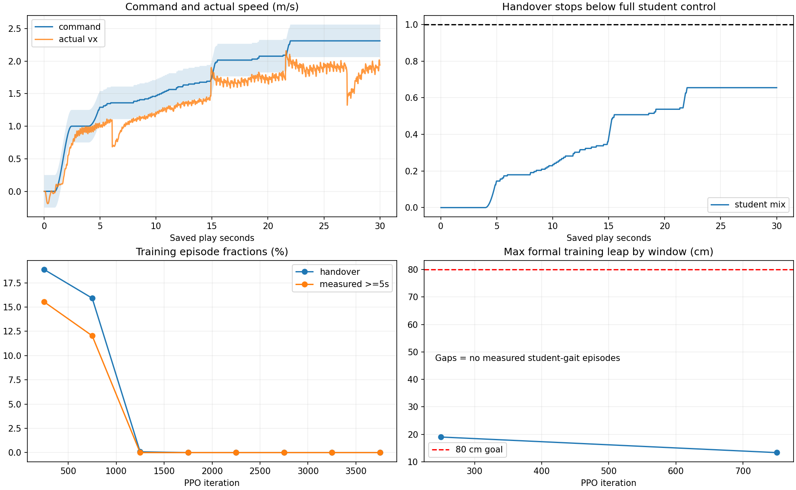

# 34,000회 결과: 3m/s·80cm 목표 진입 실패

**학습 실행은4,000회를 정상 완료했지만, 최종 정책은 보행→갤롭 혼합 단계에 정체됐다.** 저장된30초 플레이에서 학생 정책으로 완전히 전환하지 못했고,3m/s 명령까지 올라가지도 못했다. 따라서80cm 도약과 갤롭 안정성을 달성한 결과가 아니다.

이번 작업은 원본 파일과 영상만 분석했다. PPO·모방 갱신·추가 주행0이며 정책·보상·학습 설정을 변경하지 않았다. [27개 검증](verification.json), [출발 전환 분석](startup_stall_diagnostics.json), [학습 완료·영상 요약](summary.json)을 보관했다.

## 모델·학습·영상

| 항목 | 확인 결과 |
|---|---|
| 학습 실행 | `20261110_195814_959c90` |
| 최종 모델 | [model_final.pt](../../runs/isaac/train/unitree_go2_gallop/20261110_195814_959c90/model_final.pt) |
| SHA256 | `2f8bd83968d3e37e4a12a7fc69951dcfc3db0540c9d003ffa355f0a279233af6` |
| 부모 | 원래 v4 분기30k `20261106_000029_077a6f/model_final.pt` |
| 학습 완료 | 2026-11-10 20:57:23 KST / 추가4,000회·24,576,000 transition·누적34,000회 |
| 소요 시간 | 로그3,543.11초, 약59분3초 |
| 활성 목표 | 3m/s·80cm 고정 |
| 플레이 | `20261110_205857_01da09`,1,500step·30초·자연timeout |
| 영상 | [MP4](../../runs/isaac/play/unitree_go2_gallop/20261110_205857_01da09/videos/gallop-play-step-0.mp4),1,499프레임·29.98초·50fps |
| 영상 수 | 학습0·플레이1 |

checkpoint iteration3999·PPO 로그와TensorBoard4000회·유한한 가중치·부모와 달라진actor를 확인했다. 프로그램이 학습을 생략한 결과는 아니다.

## 플레이: 혼합 비중65.5%에서 정체

| 항목 | 결과 |
|---|---:|
| 정지·동결보행·혼합·완전학생 제어 표본 수 | 47 / 151 / 1,302 / **0** |
| 마지막 학생 / 동결보행 혼합 가중치 | 65.52% / 34.48% |
| 최종 전진 명령 | **2.310m/s**,3m/s 미도달 |
| 마지막2초 실제 평균 속도 | **1.863m/s** |
| 마지막2초 평균 속도 오차 | 0.448m/s |
| 혼합 진행에 필요한 속도 오차 | 0.25m/s 이하 |
| 마지막2초 속도 추종 조건 통과 | **0%** |
| 마지막2초 자세 조건 통과 | 약99.0% |
| 혼합 중 공중기 비율 | 0% |
| 갤롭 정식 측정 구간 | **0초** |
| 낙상 / episode 종료 | 0 / 30초timeout |

전환 진행이 마지막2초 동안 고정됐고 실제 속도가 명령을 못 따라갔다. 자세는 대부분 통과했으므로 이 구간에서는 속도 추종 조건이 직접적인 전환 차단 요인이다. 저장 상태는 물리 계산 후 표본이고 실제 startup 판정은 계산 전이므로 전체 구간 재계산 통과율에는 한 제어 step 차이가 있을 수 있다. 마지막 구간은 명령과 혼합 비중이 고정돼 그 영향이 작다.

`startup_blend_seconds=26.02`라는 episode 값은 혼합 단계에서 보낸 벽시계 제어 시간이다. 안정 추종을 만족했을 때만 증가하는 내부4초 혼합 진행량과 다르다.26초가 지났다고 학생 제어가 완료된 것이 아니다.

갤롭용 속도·관절·발폭·도약 지표는 완전 학생 제어 이후에 집계된다. 이번 episode의 관련0 값은 대부분 **미계측 기본값**이다. 특히 `vx_rmse=0`을 완벽한 추종으로, 발폭0을 실제 간격0으로, 도약0을 정식 갤롭의 평균 도약거리로 해석하지 않는다. 별도로 혼합 구간의 원시 접촉 상태도 확인했으며 네 발 모두 비접촉인 표본은 없었다. 초기 낙하는 갤롭으로 세지 않는다.

혼합 구간 전체 평균 속도는1.533m/s·필터 개입17.53%·roll/pitch/yaw RMS는1.07/1.21/1.50도다. 동결 보행 정책이 섞인 결과라서 이전30k의 완전 갤롭 성능과 직접적인 개선 비교로 사용하지 않는다.

## 학습 중 경향

전체19,593개 기록 중842개가 전환을 완료했고,5초 이상 학생 갤롭을 계측한 것은666개였다. 적격 집계는19,440개이며 첫 부분 episode 등153개가 제외돼 전체 기록 수와 구분한다.

| 추가학습 구간 | 완료 episode | 전환 완료 | 5초 이상 갤롭 측정 |
|---|---:|---:|---:|
| 0~500회 | 2,428 | 458 | 377 |
| 500~1,000회 | 2,400 | 382 | 289 |
| 1,000~1,500회 | 2,442 | 2 | 0 |
| 1,500~2,000회 | 2,478 | 0 | 0 |
| 2,000~2,500회 | 2,471 | 0 | 0 |
| 2,500~3,000회 | 2,451 | 0 | 0 |
| 3,000~3,500회 | 2,482 | 0 | 0 |
| 3,500~4,000회 | 2,441 | 0 | 0 |

마지막 전환 완료 episode가 기록된 위치는 약1,144회다. 이후 후반부는 완전한 학생 갤롭을 계측하지 못했다. 학습 전체 정식 tracker에 기록된 최대 도약도19.00cm로80cm에 미달했고, 전체 성공은0이다. 후반의 도약 보상이0인 것은 성능 개선 증거가 아니다.



## 원인과 설계 한계

확인된 직접 원인은 **속도 추종을 만족해야 전환이 진행되는데, 혼합 상태의 정책이 그 속도를 못 내는 것**이다. `WalkingToGallop.advance()`는 자세와 속도 오차 조건을 만족한 시간만 혼합 진행량에 더한다. 명령도 이 혼합 비중에 따라1→3m/s로 올라간다. 이번 정책에서는 진행량과 명령이2.31m/s 부근에서 정체됐다. 전환이 끝나지 않아도 이 단계에 계속 머물 수 있다.

거리 이벤트 시작도 `metric_active()`로 제한된다. 완전 학생 제어와 준비 시간이 끝나지 않으면 도약 거리 보상을 얻을 기회가 없다. 학습 후반에는 도약 보상 평균이0이지만 roll/pitch 안정 보상은 계속 들어왔다. 이는 혼합 보행에 머무는 국소 해가 형성됐을 가능성과 일치한다. 다만 보상 회피의 인과 효과를 분리한 실험은 아니다.

새 설계는 속도2.5→3, 도약14→80cm, 주기 약0.39→0.60초, 비행 구간 약0.078→0.30초와 안정성 가중치를 동시에 바꿨다. 각 변경의 효과를 분리하지 못했고, 큰 목표 변경 중 전환 정체를 막을 장치도 없었다. 기존 설정·합성 이벤트 검사는 목표·보상 연결의 일관성을 확인했지만 이 동역학적 학습 실패를 예방하지 못했다.

## 이전 모델과 다음 판단

이전30k는 완전 갤롭 측정20.84초, 평균2.496m/s·도약18.53cm·안정 착지69.81%였다. 이번34k는 완전 제어 구간 자체가 없어 같은 기준의 갤롭 성능 비교가 불가능하다. 이번 결과를 개선된 모델로 채택할 근거는 없고, 그대로 학습 횟수만 늘리는 것은 우선순위가 낮다.

다음 수정은 전환 정체를 먼저 다뤄야 한다. 안정성 확인은 유지하면서 속도 추종과 혼합 진행의 순환 의존을 분리하고, 미완료 전환에 시간 제한·실패 처리 또는 별도 비용을 주는 설계를 검토한다. 이후3m/s 적응과 긴 비행·80cm 목표를 단계적으로 도입해 한 번에 바꾸는 항목을 줄이는 것이 합리적이다. 다음 실험 부모로는 보존된30k를 우선 검토한다. **이번 분석에서는 이 변경이나 재학습을 실행하지 않았다.**

## 증거

- [완료·출처·영상 목록](summary.json), [전환 구간·학습500회별 분석](startup_stall_diagnostics.json)
- [비행 이벤트 진단](play_diagnostics.json), [자세 분석](heading_play_diagnostics.json)
- [27개 검증](verification.json), [검증 코드](source/verify.py), [원본 파일 해시](evidence_manifest.json)

검증 재실행:

```bash
cd /home/cvr/GH/go2_animalization/gallop
OPENBLAS_NUM_THREADS=1 OMP_NUM_THREADS=1 MKL_NUM_THREADS=1 \
  .venv/bin/python reports/20261110_gallop_80cm_review/source/verify.py
```
